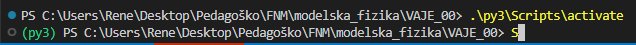

# Laboratorijski delovni list 0
## Priprava okolja: Python, virtualno okolje in knjižnice

Univerza v Mariboru · Fakulteta za naravoslovje in matematiko · Oddelek za fiziko

> [!IMPORTANT]
> **Programsko okolje: Python**
>
> Na vseh vajah uporabljamo **Python 3.10 ali novejši** in urejevalnik **VS Code** z razširitvama *Python* in *Jupyter*.
> - virtualno okolje: `python -m venv`, aktivacija, `pip install -r req.txt`
> - preizkus: [`00_vaje/test.py`](test.py) in zvezek [`00_vaje/vaje_00.ipynb`](vaje_00.ipynb)
>
> Rešitev oddate kot Jupyter zvezek `.ipynb` z izvedenimi celicami.

PDF različica: [navodila/delovni_list_00.pdf](navodila/delovni_list_00.pdf)

---

## 1. Teoretične osnove in motivacija

Modele bomo pretežno pisali v Pythonu, ponekod (vaja 04) pa ga bomo kombinirali s hitrejšim jezikom C++. Da bo koda delovala enako na vseh računalnikih in čez nekaj let, potrebujemo stabilno in ponovljivo programsko okolje.

Pogosto se zgodi, da kode, ki je včeraj delovala, danes ne moremo več zagnati: nova različica knjižnice je spremenila funkcijo ali pa projekt potrebuje drugo različico Pythona kot sosednji projekt. Zato vsak projekt dobi svoje **virtualno okolje** (angl. *virtual environment*): mapo z lastnim interpreterjem Python in lastnimi knjižnicami, ki je ločena od sistemske namestitve. Seznam knjižnic in njihovih najnižjih različic hranimo v datoteki [`req.txt`](../req.txt) v korenu repozitorija, tako da lahko enako okolje kadarkoli ponovno ustvarimo.

> **Struktura repozitorija**
>
> Vsaka vaja ima mapo `XX_vaje/` z delovnim listom `README.md` (PDF je v mapi `navodila/`), gradivom in podatki v mapi `navodila/`, začetno predlogo `vaje_XX.ipynb`, v kateri dopolnite mesta z oznako `TODO`, in rešitvijo v mapi `resitve/`. Okolje `venv/` ustvarite enkrat, v korenu repozitorija, in ga uporabljate pri vseh vajah.

---

## 2. Pripravljalna naloga (namestitev doma)

**P1. Python.** Preverite, katere različice Pythona so nameščene. V sistemu Windows uporabite `py --list`, v sistemih Linux in macOS pa `python3 --version`. Če Pythona 3.10 ali novejšega ni, ga namestite s [python.org](https://www.python.org/downloads/) (v sistemu Windows označite možnost *Add python.exe to PATH*).

Nameščene različice: `______________________`

**P2. Virtualno okolje.** V korenski mapi repozitorija ustvarite okolje `venv`, ga aktivirajte in namestite knjižnice:

```powershell
python -m venv venv              # ali npr. py -3.12 -m venv venv za izbrano različico
.\venv\Scripts\activate          # Windows (PowerShell)
source venv/bin/activate         # Linux / macOS
python -m pip install -U pip
pip install -r req.txt
```

Po aktivaciji se pred pozivom v terminalu izpiše ime okolja, npr. `(venv)`. Če PowerShell aktivacijo zavrne zaradi pravil za izvajanje skript, enkrat zaženite `Set-ExecutionPolicy -Scope CurrentUser RemoteSigned`.

<!-- w=0.75 -->


**P3. Preizkus.** Z aktiviranim okoljem v korenu repozitorija zaženite `python 00_vaje/test.py`. Skripta izpiše različice vseh knjižnic in na koncu `Vse BP`, sicer pa navede manjkajoče pakete.

Različica Pythona v okolju: `__________`  Izpis zadnje vrstice: `__________`

---

## 3. Laboratorijske naloge na računalniku (Python)

> **Repozitorij**
>
> Začetna predloga je v repozitoriju predmeta: [`00_vaje/vaje_00.ipynb`](vaje_00.ipynb). V razdelku *Funkcije* dopolnite telesa funkcij z oznako `TODO`, v razdelku *Testno območje* pa preverite, da obe funkciji za vsoto kvadratov vrneta 14.

### Naloga 1: Preizkus okolja (20 min)

1. Če doma niste uspeli, izvedite korake P1–P3.
2. V VS Code odprite mapo repozitorija in zvezek `00_vaje/vaje_00.ipynb`. Desno zgoraj izberite jedro (*Select Kernel*) iz mape `venv`.
3. Zaženite prvo celico, ki izpiše pot do interpreterja, in celico naloge 1, ki z istim interpreterjem zažene `test.py`.

| Količina | vrednost |
|---|---|
| pot do interpreterja (`sys.executable`) | `______________________` |
| različica Pythona | `______` |
| različice `numpy` / `scipy` / `matplotlib` | `______` |
| manjkajoči paketi | `______` |

*Preglednica 1: Preizkus okolja.*

### Naloga 2: Delo z zvezki (20 min)

1. Preizkusite osnovne ukaze v zvezku: nova celica (koda, Markdown), izvajanje celice (`Shift+Enter`), ponovni zagon jedra (*Restart*) in izvajanje vseh celic (*Run All*).
2. Zakaj je pred oddajo treba izvesti *Restart* in *Run All*? Preverite, kaj se zgodi, če celico, ki definira spremenljivko, izbrišete in zvezek ponovno zaženete.

Odgovor: `________________________________________`

### Naloga 3: Zanka ali numpy (25 min)

1. Dopolnite funkciji `vsota_zanka(x)` (zanka `for`) in `vsota_numpy(x)` (brez zanke), ki izračunata vsoto kvadratov elementov.
2. Izmerite čas obeh funkcij za $N = 10^4$, $10^5$ in $10^6$ naključnih števil (`time.perf_counter`).

| $N$ | zanka [ms] | numpy [ms] | razmerje | razlika vsot |
|---|---|---|---|---|
| $10^4$ | `______` | `______` | `______` | `______` |
| $10^5$ | `______` | `______` | `______` | `______` |
| $10^6$ | `______` | `______` | `______` | `______` |

*Preglednica 2: Čas izračuna vsote kvadratov.*

### Naloga 4: Prvi graf (25 min)

1. Dopolnite funkcijo `duseno_nihanje(t, A, beta, omega)`, ki vrne $x(t) = A\,e^{-\beta t}\cos\omega t$.
2. **Slika 1**: dušeno nihanje za $\beta = 0{,}1$, $0{,}3$ in $1{,}0$ ($A = 1$, $\omega = 2\pi\ \mathrm{s^{-1}}$) na intervalu $0 \le t \le 10$ s ter ovojnico $\pm e^{-0{,}3\,t}$. Dodajte oznake osi z enotami in legendo.

| $\beta$ [s$^{-1}$] | 0,1 | 0,3 | 1,0 |
|---|---|---|---|
| čas, ko ovojnica pade na 10 % [s] | `______` | `______` | `______` |

*Preglednica 3: Dušenje nihanja.*

---

## 4. Vprašanja za razpravo in zaključni zagovor

> **Razmislek 1: Zakaj virtualno okolje**
>
> Zakaj knjižnic ne nameščamo kar v sistemski Python? Kaj se zgodi, če dva projekta potrebujeta različni različici iste knjižnice? Zakaj mape `venv/` ne shranimo v repozitorij, datoteko `req.txt` pa?

> **Razmislek 2: Različice knjižnic**
>
> Kakšna je razlika med zapisoma `numpy>=1.26` in `numpy==1.26.4` v datoteki `req.txt`? Kdaj je boljši prvi in kdaj drugi? Kako s `pip freeze` zapišemo natančno stanje okolja?

> **Razmislek 3: Hitrost numpy**
>
> Zakaj je numpy hitrejši od zanke v Pythonu, čeprav naredi enako število množenj? Zakaj se vsoti razlikujeta v zadnjih decimalkah?

---

### Dodatno gradivo

- [`resitve/vaje_00_resitev.ipynb`](resitve/vaje_00_resitev.ipynb): rešitev z izvedenimi celicami
- [`test.py`](test.py): preizkus okolja
- [`navodila/README_izvirni.md`](navodila/README_izvirni.md): izvirna navodila s slikami ukazov v terminalu (`image.png`, `aktivate.png`, `odziv.png`)
