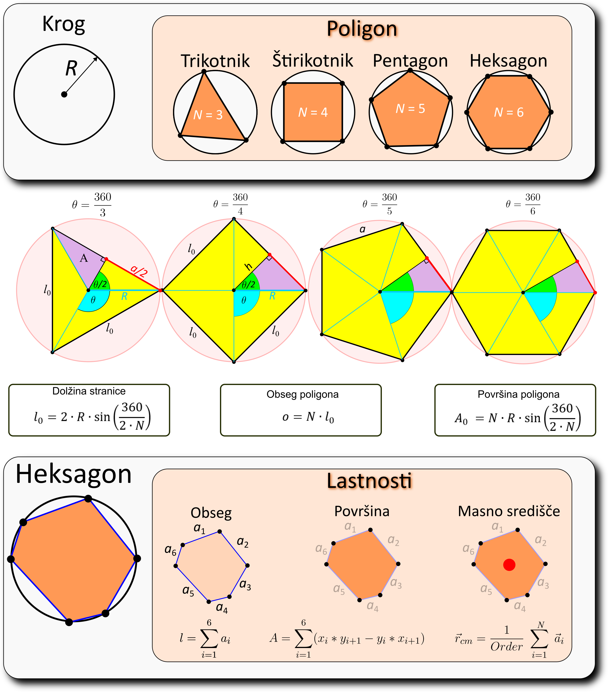

# Laboratorijski delovni list 5
## Mehanski model celice: poligon in relaksacija z metodo Monte Carlo

Univerza v Mariboru · Fakulteta za naravoslovje in matematiko · Oddelek za fiziko

> [!IMPORTANT]
> **Programsko okolje: Python**
>
> Vse naloge rešujete **izključno v Pythonu** (virtualno okolje iz [vaje 00](../00_vaje/README.md)).
> - `numpy`: `np.roll`, `np.linalg.norm`, `np.column_stack`, `np.random.default_rng`, `rng.uniform`, `rng.integers`
> - `matplotlib.pyplot`: `fill`, `plot`, `loglog`, `axhspan`, `set_aspect`
> - standardna knjižnica: `time.time`
>
> Rešitev oddate kot Jupyter zvezek `.ipynb` z izvedenimi celicami.

PDF različica: [navodila/delovni_list_05.pdf](navodila/delovni_list_05.pdf)

---

## 1. Teoretične osnove in motivacija

Oblika celic v tkivu je posledica ravnovesja mehanskih sil: notranji tlak celice se upira stiskanju, napetost celične membrane in aktinsko-miozinskega obroča pa krajšanju oziroma podaljševanju roba. V **verteksnih modelih** (angl. *vertex models*) celico opišemo kot poligon, katerega oglišča se premikajo tako, da se zmanjša mehanska energija. Na tej vaji sestavimo model ene celice in ga relaksiramo z metodo Monte Carlo. Na naslednji vaji ga bomo uporabili za rast in delitev celice.

> **Opis modela**
>
> Celico predstavimo kot $n$-kotnik, vrisan v krog s polmerom $R$. Pravilni $n$-kotnik določa želeno (referenčno) ploščino, obseg in dolžino stranic. Celico naključno popačimo in poiščemo obliko z najnižjo energijo.

<!-- w=0.5 -->


### Geometrija poligona

Za pravilni $n$-kotnik, vrisan v krog s polmerom $R$, velja

$$
l_0 = 2R\sin\frac{\pi}{n}, \qquad P_0 = n\,l_0, \qquad A_0 = \frac{n}{2}R^2\sin\frac{2\pi}{n}.
$$

Za poljuben poligon z oglišči $(x_i, y_i)$, oštevilčenimi v pozitivni smeri, izračunamo dolžine stranic, obseg in ploščino (**formula vezalk**, angl. *shoelace*):

$$
l_i = \sqrt{(x_{i+1}-x_i)^2 + (y_{i+1}-y_i)^2}, \qquad P = \sum_{i=1}^{n} l_i, \qquad A = \frac{1}{2}\left|\sum_{i=1}^{n} \left(x_i\,y_{i+1} - x_{i+1}\,y_i\right)\right|,
$$

kjer je $x_{n+1} = x_1$ in $y_{n+1} = y_1$. Masno središče oglišč je $\mathbf r_{\rm cm} = \frac{1}{n}\sum_i \mathbf r_i$.

### Mehanska energija celice

Po Farhadifarju in sod. (2007) zapišemo energijo celice kot vsoto treh prispevkov:

$$
E = \frac{K}{2}\left(A - A_0\right)^2 + \frac{\Gamma}{2}\left(P - P_0\right)^2 + \frac{\lambda}{2}\sum_{i=1}^{n}\left(l_i - l_0\right)^2 .
$$

Prvi člen opisuje elastičnost ploščine (stisljivost celice), drugi krčljivost obsega, tretji pa napetost posameznih stranic. Uporabimo $K = \Gamma = \lambda = 1$. Pravilni $n$-kotnik ima energijo $E = 0$. Ker energija ni odvisna od premika in zasuka celice, ima minimum tri ničelne smeri.

### Relaksacija z metodo Monte Carlo

Minimum energije iščemo z naključnimi poskusi:

1. naključno izberemo oglišče $i$ in ga premaknemo za $\delta\mathbf r$, kjer sta komponenti enakomerno porazdeljeni na $[-a, a]$,
2. izračunamo spremembo energije $\Delta E = E_{\rm nova} - E_{\rm stara}$,
3. potezo sprejmemo po **pohlepnem kriteriju** (le, če je $\Delta E < 0$) ali po **Metropolisovem kriteriju** z verjetnostjo

$$
p_{\rm spr} = \min\left(1,\ e^{-\Delta E/T}\right),
$$

4. velikost koraka $a$ sproti prilagajamo: če je delež sprejetih potez (drseče povprečje) premajhen, korak zmanjšamo, če je prevelik, ga povečamo.

Pri $T = 0$ je Metropolisov algoritem enak pohlepnemu. Pri $T > 0$ celica niha okoli minimuma. Za majhne odmike je energija približno kvadratna v $f$ neodvisnih smereh, zato po **ekviparticijskem izreku** velja $\langle E\rangle \approx \tfrac{f}{2}\,T$.

---

## 2. Pripravljalna naloga (analitični del)

**P1. Pravilni poligoni.** Izračunajte $l_0$, $P_0$ in $A_0$ za kvadrat in pravilni šestkotnik z $R = 1$. Kolikšni sta razmerji $A_0/(\pi R^2)$ in $P_0/(2\pi R)$ za šestkotnik? Pokažite, da gresta obe razmerji proti 1, ko $n \to \infty$.

| $n$ | $l_0$ | $P_0$ | $A_0$ | $A_0/\pi R^2$ | $P_0/2\pi R$ |
|---|---|---|---|---|---|
| 4 | `______` | `______` | `______` | `______` | `______` |
| 6 | `______` | `______` | `______` | `______` | `______` |

*Preglednica P1: Lastnosti pravilnih poligonov z $R = 1$.*

**P2. Formula vezalk.** S formulo vezalk izračunajte ploščino pravokotnika z oglišči $(0,0)$, $(2,0)$, $(2,1)$, $(0,1)$. Kaj se zgodi s predznakom vsote, če oglišča oštevilčimo v nasprotni smeri? Kje je masno središče oglišč?

$A=$ `________`  $\mathbf r_{\rm cm}=$ `________`

**P3. Povečana celica.** Pravilni šestkotnik ($R=1$) enakomerno povečamo za faktor $s$. Zapišite $E(s)$ in izračunajte $E(1{,}1)$. Kateri od treh členov največ prispeva?

$E(s)=$ `____________________`  $E(1{,}1)=$ `__________`

**P4. Metropolis in ekviparticija.** S kolikšno verjetnostjo sprejmemo potezo z $\Delta E = 0{,}01$ pri $T = 10^{-3}$ in pri $T = 10^{-2}$? Koliko neodvisnih smeri $f$ ima energija šestkotnika v okolici minimuma (upoštevajte ničelne smeri)? Kolikšno povprečno energijo pričakujete pri $T = 10^{-3}$?

$p(10^{-3})=$ `________`  $p(10^{-2})=$ `________`  $f=$ `________`  $\langle E\rangle=$ `________`

---

## 3. Laboratorijske naloge na računalniku (Python)

> **Repozitorij**
>
> Začetna predloga je v repozitoriju predmeta: [`05_vaje/vaje_05.ipynb`](vaje_05.ipynb). V razdelku *Funkcije* dopolnite telesa funkcij z oznako `TODO`, v razdelku *Testno območje* pa preverite rezultate nalog P1–P3.

### Naloga 1: Geometrija poligona (20 min)

1. Dopolnite funkcije `stranice`, `obseg`, `ploscina` (formula vezalk z `np.roll`), `tezisce` in `referencne(R, n)`. Funkcija `poligon(R, n, eps)` že vrne oglišča, popačena z relativnim šumom `eps`.
2. **Slika 2**: pravilni in popačeni ($\varepsilon = 0{,}2$) poligoni za $n = 3, \dots, 8$.
3. **Slika 3**: razmerji $A/\pi R^2$ in $P/2\pi R$ za $n = 3, \dots, 100$, izračunani iz oglišč.

```python
def ploscina(t):
    x, y = t[:, 0], t[:, 1]
    return 0.5 * abs(np.sum(x * np.roll(y, -1) - ...))   # TODO
```

| $n$ | $A_0$ (analitično) | $A$ (numerično) | $A/\pi R^2$ | $P/2\pi R$ |
|---|---|---|---|---|
| 3 | `______` | `______` | `______` | `______` |
| 6 | `______` | `______` | `______` | `______` |
| 12 | `______` | `______` | `______` | `______` |
| 100 | `______` | `______` | `______` | `______` |

*Preglednica 1: Primerjava analitičnih in numeričnih lastnosti poligonov.*

### Naloga 2: Energija celice (15 min)

1. Dopolnite funkcijo `energija(t, ref)`, kjer je `ref = (A0, P0, l0)`. Preverite, da je energija pravilnega poligona enaka nič.
2. **Slika 4**: povprečna energija 200 naključno popačenih šestkotnikov v odvisnosti od $\varepsilon \in [0;\ 0{,}5]$ v log–log merilu. Določite naklon in ga pojasnite.
3. Za popačen šestkotnik iz predloge ($\varepsilon = 0{,}3$) izračunajte posamezne prispevke k energiji.

| Količina | Vrednost |
|---|---|
| $A$ in $P$ popačenega šestkotnika | `__________` |
| $E_A = \frac{K}{2}(A-A_0)^2$ | `__________` |
| $E_P = \frac{\Gamma}{2}(P-P_0)^2$ | `__________` |
| $E_l = \frac{\lambda}{2}\sum(l_i-l_0)^2$ | `__________` |
| naklon $\log\langle E\rangle$ proti $\log\varepsilon$ | `__________` |

*Preglednica 2: Prispevki k energiji popačenega šestkotnika.*

### Naloga 3: Pohlepna relaksacija (30 min)

1. V funkciji `relaksacija_mc` dopolnite kriterij sprejetja in prilagajanje koraka. Delež sprejetih potez $p$ je drseče povprečje $p \leftarrow 0{,}99\,p + 0{,}01\cdot[\text{sprejeto}]$. Korak pomnožite z $0{,}99$, če je $p$ pod ciljnim intervalom, in z $1{,}01$, če je nad njim.
2. Relaksirajte popačeni šestkotnik z $20\,000$ poskusi in ciljnim intervalom $p \in [0{,}2;\ 0{,}3]$.
3. **Slika 5** (štirje paneli): začetna in relaksirana celica, $E$, $p$ in velikost koraka v odvisnosti od iteracije (log–log).
4. Relaksacijo ponovite za $n = 4, 6, 8, 12$ in za ciljna intervala $[0{,}2;\ 0{,}3]$ ter $[0{,}4;\ 0{,}6]$.

| $n$ | $E_{\rm z}$ | $E_{\rm k}$ (a) | $N_{\rm it}$ (a) | $E_{\rm k}$ (b) | $N_{\rm it}$ (b) |
|---|---|---|---|---|---|
| 4 | `______` | `______` | `______` | `______` | `______` |
| 6 | `______` | `______` | `______` | `______` | `______` |
| 8 | `______` | `______` | `______` | `______` | `______` |
| 12 | `______` | `______` | `______` | `______` | `______` |

*Preglednica 3: Pohlepna relaksacija: začetna ($E_{\rm z}$) in končna ($E_{\rm k}$) energija ter število iteracij $N_{\rm it}$ do $E<10^{-4}$ za ciljni interval (a) $[0{,}2;\ 0{,}3]$ in (b) $[0{,}4;\ 0{,}6]$.*

### Naloga 4: Metropolisov algoritem (25 min)

Popačeni šestkotnik relaksirajte z Metropolisovim kriterijem pri $T \in \{0;\ 10^{-4};\ 10^{-3};\ 10^{-2}\}$ s stalnim korakom $a = 0{,}02$ (brez prilagajanja). **Slika 6**: $E$ v odvisnosti od iteracije za vse temperature. Povprečno energijo in delež sprejetih potez izračunajte iz druge polovice simulacije ter ju primerjajte z napovedjo ekviparticijskega izreka (P4).

| $T$ | $\langle E\rangle$ | $\sigma_E$ | $\langle E\rangle/T$ | delež sprejetih | $A$ končne celice |
|---|---|---|---|---|---|
| 0 | `______` | `______` | – | `______` | `______` |
| $10^{-4}$ | `______` | `______` | `______` | `______` | `______` |
| $10^{-3}$ | `______` | `______` | `______` | `______` | `______` |
| $10^{-2}$ | `______` | `______` | `______` | `______` | `______` |

*Preglednica 4: Metropolisova relaksacija pri različnih temperaturah.*

---

## 4. Vprašanja za razpravo in zaključni zagovor

> **Razmislek 1: Kdaj je celica v minimumu?**
>
> Pri pohlepnem algoritmu se energija le zmanjšuje. Kako bi določili, da je relaksacija končana? Zakaj se energija na koncu zmanjšuje vse počasneje? Zakaj se masno središče in usmerjenost relaksirane celice razlikujeta od začetnih?

> **Razmislek 2: Izbira koraka**
>
> Zakaj je pri pohlepnem iskanju minimuma ugodnejši manjši ciljni delež sprejetih potez kot pri vzorčenju z Metropolisovim algoritmom? Kaj se zgodi, če je korak bistveno prevelik ali bistveno premajhen?

> **Razmislek 3: Temperatura**
>
> Pojasnite, zakaj je $\langle E\rangle/T$ pri vseh temperaturah približno enak. Pri kateri temperaturi bi približek kvadratne energije odpovedal? Kaj v realni celici ustreza »temperaturi« v našem modelu?

> **Razmislek 4: Uteži energije (domača naloga)**
>
> Relaksacijo ponovite z $K = 10$, $\Gamma = \lambda = 1$ in s $K = 1$, $\Gamma = 0$, $\lambda = 1$. Kako se spremenita hitrost relaksacije in končna oblika? Ali ima energija s $\lambda = 0$ še enoličen minimum?

---

### Dodatno gradivo

- [`resitve/vaje_05_resitev.ipynb`](resitve/vaje_05_resitev.ipynb): rešitev z izvedenimi celicami
- [`navodila/Matematični model tkiva.pptx`](navodila/Matematični%20model%20tkiva.pptx): prosojnice s predavanj (slike posameznih prosojnic v mapi `navodila/prosojnice/` so le lokalno, niso v repozitoriju)
- [`navodila/00_cellg.png`](navodila/00_cellg.png): cikel rasti in delitve celice (vaja 06)
- [`navodila/cellg.svg`](navodila/cellg.svg), [`navodila/Cell_single_v2.svg`](navodila/Cell_single_v2.svg): vektorska izvirnika slik celice
