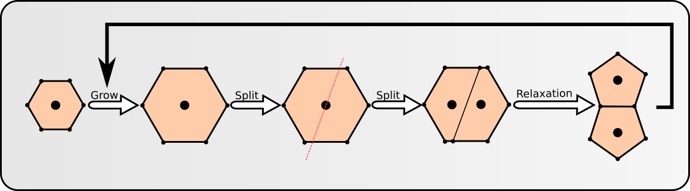

# Laboratorijski delovni list 6
## Model tkiva: gradientni spust, rast in delitev celice

Univerza v Mariboru · Fakulteta za naravoslovje in matematiko · Oddelek za fiziko

> [!IMPORTANT]
> **Programsko okolje: Python**
>
> Vse naloge rešujete **izključno v Pythonu** (virtualno okolje iz [vaje 00](../00_vaje/README.md)).
> - `numpy`: `np.roll`, `np.linalg.norm`, `np.linalg.eigh`, `np.cov`, `np.interp`, `np.cumsum`
> - `matplotlib.pyplot`: `fill`, `plot`, `semilogy`, `set_aspect`
> - standardna knjižnica: `time.time`
>
> Rešitev oddate kot Jupyter zvezek `.ipynb` z izvedenimi celicami.

PDF različica: [navodila/delovni_list_06.pdf](navodila/delovni_list_06.pdf)

---

## 1. Teoretične osnove in motivacija

Tkivo nastaja z rastjo in delitvijo celic. Celica med celičnim ciklom raste, se razdeli na dve hčerinski celici, ki se nato mehansko uravnovesita. Na vaji 5 smo celico relaksirali z metodo Monte Carlo. Danes za relaksacijo uporabimo **gradientni spust** in z njim simuliramo en celični cikel: rast, delitev in relaksacijo hčerinskih celic.

> **Opis modela**
>
> Uporabimo model celice z vaje 5: poligon z $n = 6$ oglišči in energijo $E = \frac{K}{2}(A-A_0)^2 + \frac{\Gamma}{2}(P-P_0)^2 + \frac{\lambda}{2}\sum_i (l_i - l_0)^2$, kjer referenčne vrednosti določa pravilni šestkotnik. Rast opišemo s postopnim povečevanjem referenčne ploščine, delitev pa z rezom celice s premico skozi njeno težišče. Hčerinski celici si po delitvi delita stranico in njeni krajišči, zato tkivo opišemo s skupnim seznamom točk in s celicami kot seznami indeksov teh točk.

<!-- w=0.7 -->


### Gradientni spust

Energija je funkcija vseh koordinat oglišč $\mathbf r = (x_1, y_1, \dots, x_n, y_n)$. Gradientni spust oglišča premika v smeri največjega padca energije:

$$
\mathbf r_{k+1} = \mathbf r_k - \eta\,\nabla E(\mathbf r_k),
$$

kjer je $\eta$ **učni korak**. Za kvadratno funkcijo $E(x) = k\,(x - x_0)^2$ je $\nabla E = 2k(x - x_0)$ in odmik od minimuma se v vsakem koraku pomnoži s faktorjem

$$
x_{k+1} - x_0 = (1 - 2k\eta)\,(x_k - x_0).
$$

Metoda konvergira, če je $|1 - 2k\eta| < 1$. V več dimenzijah stabilnost določa najbolj strma smer (največja ukrivljenost energije), hitrost konvergence pa najpoložnejša smer.

### Numerični in analitični gradient

Če analitičnega gradienta nimamo, ga izračunamo s **centralnimi diferencami**:

$$
\frac{\partial E}{\partial x_i} \approx \frac{E(x_i + h) - E(x_i - h)}{2h},
$$

z napako reda $h^2$. Za en gradient potrebujemo $4n$ izračunov energije. Za nekatere člene gradient poznamo analitično. Iz formule vezalk sledi gradient ploščine

$$
\frac{\partial A}{\partial x_i} = \frac{y_{i+1} - y_{i-1}}{2}, \qquad \frac{\partial A}{\partial y_i} = \frac{x_{i-1} - x_{i+1}}{2}.
$$

### Tkivo: skupne točke in celice

Tkivo zapišemo z dvema podatkovnima strukturama: tabelo vseh točk (oglišč) `tocke` velikosti $M\times 2$ in seznamom celic `celice`, kjer je vsaka celica seznam indeksov točk v pozitivni smeri, na primer `[[0, 1, 2, 3, 4, 5]]` za eno šestkotno celico. Točka, ki pripada več celicam, je zapisana le enkrat, zato jo vse celice »vidijo« na istem mestu. Energija tkiva je vsota energij celic

$$
E_{\rm tkivo} = \sum_{\alpha} E_\alpha, \qquad E_\alpha = \frac{K}{2}(A_\alpha - A_{0,\alpha})^2 + \frac{\Gamma}{2}(P_\alpha - P_{0,\alpha})^2 + \frac{\lambda}{2}\sum_{i\in\alpha}(l_i - l_{0,\alpha})^2,
$$

kjer referenčne vrednosti celice z $n_\alpha$ oglišči določa pravilni $n_\alpha$-kotnik s ploščino $A_{0,\alpha}$. Gradientni spust premika vse točke hkrati. Na skupno točko delujejo prispevki vseh celic, ki jo vsebujejo, zato sosednji celici ostaneta stični.

### Rast celice

Celica raste tako, da njeno referenčno ploščino v $N$ korakih povečamo z $A_0$ na $2A_0$:

$$
A_{0}^{(k)} = A_0\left(1 + \frac{k}{N}\right), \qquad k = 1, \dots, N,
$$

tkivo pa po vsakem koraku relaksiramo.

### Delitev celice

Skozi težišče $\mathbf c$ celice postavimo premico z naključno smerjo $\varphi$ in normalo $\hat{\mathbf n} = (-\sin\varphi, \cos\varphi)$. Predznačena razdalja oglišča od premice je $s_i = (\mathbf r_i - \mathbf c)\cdot\hat{\mathbf n}$. Premica seka natanko tisti stranici, pri katerih se predznak spremeni ($s_i s_{i+1} < 0$). Na vsaki od njiju ustvarimo novo točko

$$
\mathbf p = \mathbf r_i + \frac{s_i}{s_i - s_{i+1}}\,(\mathbf r_{i+1} - \mathbf r_i)
$$

in jo dodamo na konec tabele točk. Nato posodobimo seznam celic:

1. Naj bosta $m_1$ in $m_2$ indeksa novih točk na stranicah, ki se začneta na mestih $i_1 < i_2$ v seznamu celice $c$. Hčeri sta `[m1] + c[i1+1 : i2+1] + [m2]` in `[m2] + c[i2+1:] + c[:i1+1] + [m1]`. Obe sta v pozitivni smeri in si delita stranico $(m_1, m_2)$.
2. Prva hči nadomesti celico $c$, druga se doda na konec seznama celic.
3. Če presekano stranico $(a, b)$ vsebuje tudi sosednja celica, vanjo med $a$ in $b$ vstavimo novo točko, sicer bi v tkivu nastala luknja.

Hčeri nato relaksiramo k referenčni ploščini $A_0$ prvotne celice. Po **Hertwigovem pravilu** se celice v naravi pogosto delijo pravokotno na dolgo os, ki jo določa lastni vektor kovariančne matrike oglišč z največjo lastno vrednostjo (funkcija `dolga_os`).

---

## 2. Pripravljalna naloga (analitični del)

**P1. Stabilnost gradientnega spusta.** Za $E(x) = 10\,(x-1)^2$ določite, za katere $\eta$ gradientni spust (a) monotono konvergira, (b) konvergira z nihanjem, (c) divergira. Pri katerem $\eta$ pridemo do minimuma v enem koraku?

| $\eta$ | 0,01 | 0,04 | 0,06 | 0,09 | 0,11 |
|---|---|---|---|---|---|
| $1 - 2k\eta$ | `______` | `______` | `______` | `______` | `______` |
| vedenje | `______` | `______` | `______` | `______` | `______` |

*Preglednica P1: Napoved vedenja gradientnega spusta.*

$\eta_{\rm opt}=$ `__________`

**P2. Cena gradienta.** Koliko izračunov energije potrebuje ena iteracija gradientnega spusta s centralnimi diferencami za šestkotnik? Koliko izračunov energije potrebuje en poskus metode Monte Carlo z vaje 5? Kakšen je red napake centralne in kakšen enostranske diference?

GS: `__________`  MC: `__________`  napaka: `__________`

**P3. Gradient ploščine.** Iz formule vezalk izpeljite $\partial A/\partial x_i$ in $\partial A/\partial y_i$. Izračunajte $\nabla_1 A$ za oglišče $(1,1)$ kvadrata z oglišči $(1,1)$, $(-1,1)$, $(-1,-1)$, $(1,-1)$. Kam kaže?

$\nabla_1 A=$ `__________`

**P4. Delitev.** Kvadrat iz P3 (točke $0$–$3$, celica `[0, 1, 2, 3]`) razrežemo s premico $y = 0$. Zapišite nova seznama celic z indeksi novih točk $4$ in $5$. Koliko oglišč in kolikšno ploščino ima vsaka hči? Kateri točki sta skupni? Koliko oglišč ima vsaka hči šestkotnika, ki ga premica preseka na dveh nasprotnih stranicah? Kolikšen je polmer $R$ šestkotnika z dvojno ploščino?

kvadrat: `__________________`  šestkotnik: `__________`  $R(2A_0)=$ `__________`

---

## 3. Laboratorijske naloge na računalniku (Python)

> **Repozitorij**
>
> Začetna predloga je v repozitoriju predmeta: [`06_vaje/vaje_06.ipynb`](vaje_06.ipynb). Model celice z vaje 5 je že vnesen. V razdelku *Funkcije* dopolnite telesa funkcij z oznako `TODO`, v razdelku *Testno območje* pa preverite rezultata nalog P3 in P4.

### Naloga 1: Gradientni spust v eni dimenziji (15 min)

Dopolnite funkcijo `gs_1d(x, k, eta)` in izvedite 40 korakov za $k = 10$, $x_{\rm začetni} = 2$ in vse $\eta$ iz P1. **Slika 2** (dva panela): (A) $x_k$ in (B) $E_k$ (logaritemska os) v odvisnosti od iteracije. Iz prvih dveh korakov izmerite razmerje $|x_{k+1}-x_0|/|x_k-x_0|$ in ga primerjajte z napovedjo.

| $\eta$ | napoved $1-2k\eta$ | izmerjeno razmerje | vedenje |
|---|---|---|---|
| 0,01 | `______` | `______` | `______` |
| 0,04 | `______` | `______` | `______` |
| 0,06 | `______` | `______` | `______` |
| 0,09 | `______` | `______` | `______` |
| 0,11 | `______` | `______` | `______` |

*Preglednica 1: Gradientni spust za $E = 10\,(x-1)^2$.*

### Naloga 2: Relaksacija celice z gradientnim spustom (25 min)

1. Dopolnite funkcijo `gradient(t, ref)` (centralne diference, $h = 10^{-6}$) in `gradient_ploscine(t)`. V *Testnem območju* primerjajte analitični in numerični gradient ploščine.
2. Dopolnite funkcijo `gradientni_spust(t, ref, eta)`, ki vrne končno celico ter zgodovino energije in norme gradienta.
3. Popačen šestkotnik iz predloge relaksirajte z $\eta \in \{0{,}01;\ 0{,}05;\ 0{,}1;\ 0{,}2\}$ in izpolnite preglednico. Rezultat primerjajte s pohlepno metodo Monte Carlo z vaje 5.
4. **Slika 3** (trije paneli) za $\eta = 0{,}1$: začetna in relaksirana celica, $E$ ter $|\nabla E|$ v odvisnosti od iteracije.

| $\eta$ | iteracij do $E<10^{-4}$ | izračunov $E$ do $E<10^{-4}$ | $E$ po 2000 iteracijah |
|---|---|---|---|
| 0,01 | `______` | `______` | `______` |
| 0,05 | `______` | `______` | `______` |
| 0,1 | `______` | `______` | `______` |
| 0,2 | `______` | `______` | `______` |
| MC (vaja 5) | `______` | `______` | `______` |

*Preglednica 2: Učinkovitost gradientnega spusta.*

### Naloga 3: Tkivo in rast celice (20 min)

1. Dopolnite funkciji `energija_tkiva(tocke, celice, A0)` in `relaksacija_tkiva(tocke, celice, A0, eta)`. Funkcija `gradient_tkiva` že izračuna numerični gradient po vseh točkah.
2. Dopolnite funkcijo `rast(tocke, celice, A0, rastoce, faktor, koraki)`.
3. Tkivo z eno celico (pravilni šestkotnik z $R_0 = 1$, `celice = [[0, 1, 2, 3, 4, 5]]`) v $10$ korakih povečajte do dvojne ploščine in ga po vsakem koraku relaksirajte ($\eta = 0{,}05$, največ $300$ iteracij). **Slika 4** (dva panela): (A) celica pred rastjo in po njej, (B) $A/A_0$ v odvisnosti od koraka rasti.

| Količina | Vrednost |
|---|---|
| $A$ pred rastjo in po njej | `__________` |
| energija po rasti | `__________` |
| polmer zrasle celice (primerjava s P4) | `__________` |

*Preglednica 3: Rast celice do dvojne ploščine.*

### Naloga 4: Delitev celice (30 min)

1. Dopolnite funkcijo `deli_celico(tocke, celice, k, kot)`: za stranice, ki jih premica seka, izračunajte presečišče, ga dodajte v tabelo točk, vstavite ga v sosednje celice (`vstavi_v_sosede`) in sestavite seznama hčera. V *Testnem območju* preverite P4.
2. Zraslo celico iz naloge 3 razdelite s premico skozi težišče z naključno smerjo. Izpišite seznam celic in preverite, da imata hčeri natanko dve skupni točki.
3. Tkivo relaksirajte, pri čemer hčeri želita ploščino $A_0$ prvotne celice ($\eta = 0{,}05$, $1000$ iteracij). **Slika 5** (trije paneli, z oznakami točk): mati, hčeri po delitvi in po relaksaciji.
4. Druga generacija: obe hčeri zrastita do dvojne ploščine, vsaka se razdeli z naključno premico, tkivo s štirimi celicami pa relaksirajte ($2000$ iteracij). **Slika 6**: tkivo po drugi delitvi in po relaksaciji. Preverite, da je nova točka na skupni stranici vstavljena v obe sosednji celici.

```python
p = P[i] + s[i] / (s[i] - s[j]) * (P[j] - P[i])     # presečišče na stranici c[i] -> c[j]
tocke = np.vstack([tocke, p])                        # nova točka ima indeks len(tocke) - 1
celice[k] = [m1] + c[i1 + 1:i2 + 1] + [m2]           # prva hči
celice.append([m2] + c[i2 + 1:] + c[:i1 + 1] + [m1]) # druga hči
```

| Količina | 1. generacija (2 celici) | 2. generacija (4 celice) |
|---|---|---|
| število točk | `______` | `______` |
| seznami celic (indeksi) | `______________` | `______________` |
| ploščine po delitvi | `______________` | `______________` |
| ploščine po relaksaciji | `______________` | `______________` |
| energija pred relaksacijo in po njej | `______________` | `______________` |

*Preglednica 4: Delitev celic v tkivu ($A_0 = 2{,}598$).*

---

## 4. Vprašanja za razpravo in zaključni zagovor

> **Razmislek 1: Gradientni spust ali Monte Carlo?**
>
> Katera metoda je potrebovala manj izračunov energije za $E<10^{-4}$? Kako bi se primerjava spremenila, če bi imeli analitični gradient celotne energije? Zakaj se gradientni spust v bližini minimuma upočasni, čeprav je korak stalen?

> **Razmislek 2: Izbira učnega koraka**
>
> Zakaj je gradientni spust pri $\eta = 0{,}2$ divergiral? Kako je največji stabilni korak povezan z ukrivljenostjo energije? Predlagajte metodo, ki korak sproti prilagaja (npr. iskanje po premici ali zmanjšanje koraka, ko energija naraste).

> **Razmislek 3: Pravila delitve**
>
> Ali premica skozi težišče oglišč vedno razdeli celico na dve enaki ploščini? Kdaj ne? Zakaj je rez pravokotno na dolgo os najkrajši (Hertwigovo pravilo)? Kaj bi se zgodilo, če bi premica šla natanko skozi oglišče celice, in kako bi to obravnavali v kodi?

> **Razmislek 4: Večje tkivo (domača naloga)**
>
> Zakaj je pri delitvi nujno novo točko vstaviti tudi v sosednjo celico? Kaj bi se zgodilo z energijo in obliko tkiva, če tega ne bi storili? Simulacijo nadaljujte do 8 ali 16 celic. Kako se s številom celic spreminja porazdelitev števila sosedov (oglišč) celic in kako to primerjate z opažanji v epitelijskih tkivih, kjer prevladujejo šestkotne celice?

---

### Dodatno gradivo

- [`resitve/vaje_06_resitev.ipynb`](resitve/vaje_06_resitev.ipynb): rešitev z izvedenimi celicami
- [`navodila/00_cellg.png`](navodila/00_cellg.png): shema celičnega cikla (kopija iz vaje 05)
- Prosojnice s predavanj so v [`../05_vaje/navodila/`](../05_vaje/navodila/)
