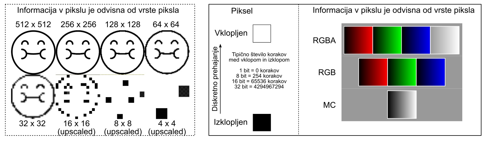
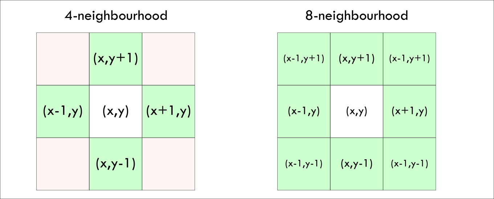

# Laboratorijski delovni list 9
## Segmentacija slik I: kanali, histogram in pragovna segmentacija

Univerza v Mariboru · Fakulteta za naravoslovje in matematiko · Oddelek za fiziko

> [!IMPORTANT]
> **Programsko okolje: Python**
>
> Vse naloge rešujete **izključno v Pythonu** (virtualno okolje iz [vaje 00](../00_vaje/README.md)).
> - `opencv-python`: `cv2.imread`, `cv2.cvtColor`
> - `numpy`: `np.bincount`, `np.cumsum`, `np.indices`, `np.argmax`
> - `scipy.ndimage`: `label`, `binary_fill_holes`; `skimage.filters`: `threshold_otsu`
> - `matplotlib.pyplot`: `imshow`, `hist`
>
> Rešitev oddate kot Jupyter zvezek `.ipynb` z izvedenimi celicami.

PDF različica: [navodila/delovni_list_09.pdf](navodila/delovni_list_09.pdf)

---

## 1. Teoretične osnove in motivacija

Slike so pogost vir eksperimentalnih podatkov: mikroskopski posnetki celic, posnetki delcev v tekočini, satelitske slike. Da iz slike izluščimo kvantitativne podatke (število, velikost, obliko objektov), jo moramo najprej **segmentirati**: vsakemu pikslu pripisati, ali pripada objektu (ospredju) ali ozadju, in nato piksle združiti v posamezne objekte. Na tej vaji spoznamo zapis digitalne slike, pragovno segmentacijo z Otsujevo metodo in označevanje povezanih območij. Na vaji 10 bomo postopek uporabili na eksperimentalni sliki.

> **Opis modela**
>
> Sivinsko sliko obravnavamo kot funkcijo $f(x,y)$ na mreži pikslov. Ospredje določimo s pragom $T$ (nekontekstualna segmentacija), sosednje piksle ospredja pa nato združimo v objekte (kontekstualna segmentacija). Za vsak objekt izračunamo ploščino in težišče.

<!-- w=0.95 -->


### Digitalna slika

Slika je tridimenzionalna tabela velikosti $H \times W \times C$: višina, širina in število kanalov. Sivinska slika ima en kanal, barvna tri (R, G, B), slika s prosojnostjo štiri (R, G, B, A). Vrednosti so najpogosteje 8-bitna cela števila (`uint8`, $0$–$255$). Pozor: **OpenCV sliko naloži v vrstnem redu BGR**, zato jo s `cv2.cvtColor` pretvorimo v RGB. Pri računanju z `uint8` lahko pride do prekoračitve ($200 + 100 = 44$), zato vrednosti pred računanjem pretvorimo v `float`.

### Svetlost piksla

Barvno sliko pred segmentacijo pogosto pretvorimo v sivinsko. Svetlost piksla lahko določimo na več načinov:

$$
\begin{aligned} L_{\rm povp} &= \frac{R+G+B}{3}, & L_{\rm ut} &= 0{,}299\,R + 0{,}587\,G + 0{,}114\,B,\\ L_{\max} &= \max(R,G,B), & L_{\min} &= \min(R,G,B). \end{aligned}
$$

Utežena vsota upošteva, da je človeško oko najbolj občutljivo za zeleno svetlobo.

### Pragovna segmentacija in Otsujeva metoda

Pri pragu $T$ piksle razdelimo v dva razreda: $f \le T$ in $f > T$. Če je histogram dvovrhov, je smiseln prag med vrhovoma. Otsujeva metoda izbere prag, pri katerem je **varianca med razredoma** največja (in s tem varianca znotraj razredov najmanjša). Naj bo $p_i$ normiran histogram, $\omega_0(T) = \sum_{i\le T} p_i$ delež pikslov v razredu 0, $\mu(T) = \sum_{i \le T} i\,p_i$ in $\mu_T = \mu(255)$. Potem je

$$
\sigma_b^2(T) = \omega_0\,\omega_1\,(\mu_0 - \mu_1)^2 = \frac{\left[\mu_T\,\omega_0(T) - \mu(T)\right]^2}{\omega_0(T)\left[1 - \omega_0(T)\right]}, \qquad T_{\rm Otsu} = \arg\max_T \sigma_b^2(T).
$$

Obe kumulativni vsoti izračunamo naenkrat za vse $T$ z `np.cumsum`.

### Povezanost pikslov in označevanje območij

Piksel $(x,y)$ ima v **soseščini N4** štiri sosede (levo, desno, gor, dol), v **soseščini N8** pa še štiri diagonalne. Objekt je povezano območje pikslov ospredja. Območja označimo z **zapolnjevanjem**: poiščemo neoznačen piksel ospredja, mu dodelimo novo oznako, ga damo na sklad in nato, dokler sklad ni prazen, z njega jemljemo piksle ter označimo in na sklad dodamo vse njihove neoznačene sosede v ospredju. Rekurzivna izvedba pri velikih objektih preseže največjo globino rekurzije, zato uporabimo sklad.

<!-- w=0.7 -->


Za objekt $k$ z množico pikslov $\Omega_k$ sta ploščina in težišče

$$
A_k = |\Omega_k|, \qquad (\bar y_k, \bar x_k) = \frac{1}{A_k}\sum_{(y,x)\in\Omega_k} (y, x).
$$

---

## 2. Pripravljalna naloga (analitični del)

**P1. Pomnilnik.** Koliko kB pomnilnika zasede sivinska slika $1026 \times 1024$ pikslov z 8 biti na piksel? Koliko slika RGBA velikosti $92 \times 92$? Koliko različnih vrednosti lahko zavzame piksel pri 1, 8 in 16 bitih?

sivinska: `________`  RGBA: `________`  1/8/16 bitov: `____________`

**P2. Svetlost.** Za piksel $(R,G,B) = (200, 50, 50)$ izračunajte svetlost po vseh štirih formulah. Kaj vrne vsota $R+G+B$, če jo izračunamo v tipu `uint8`?

$L_{\rm povp}=$ `______`  $L_{\rm ut}=$ `______`  $L_{\max}=$ `______`  $L_{\min}=$ `______`  `uint8`: `______`

**P3. Otsu na roke.** Slika ima 6 pikslov z vrednostmi $1, 1, 2, 7, 8, 8$. Izračunajte $\sigma_b^2(T) = \omega_0\omega_1(\mu_0 - \mu_1)^2$ za $T = 1$, $2$ in $7$. Kateri prag izbere Otsujeva metoda?

$\sigma_b^2(1)=$ `______`  $\sigma_b^2(2)=$ `______`  $\sigma_b^2(7)=$ `______`  $T_{\rm Otsu}=$ `______`

**P4. N4 in N8.** Koliko povezanih območij ima spodnja binarna slika v soseščini N4 in koliko v soseščini N8?

$$
\begin{pmatrix} 1&1&0&0&0\\ 1&0&0&1&1\\ 0&0&1&0&1\\ 0&1&0&0&0\\ 1&0&0&1&1 \end{pmatrix}
$$

N4: `________`  N8: `________`

---

## 3. Laboratorijske naloge na računalniku (Python)

> **Repozitorij**
>
> Začetna predloga je v repozitoriju predmeta: [`09_vaje/vaje_09.ipynb`](vaje_09.ipynb), slike pa v mapi [`09_vaje/navodila/Gradivo/`](navodila/Gradivo/). V razdelku *Funkcije* dopolnite telesa funkcij z oznako `TODO`, v razdelku *Testno območje* pa preverite rezultate nalog P2–P4.

### Naloga 1: Zapis slike in kanali (15 min)

1. Funkcija `nalozi(ime)` sliko naloži in kanale preuredi v RGB(A). Dopolnite funkcijo `opisi(img)`, ki vrne višino, širino, število kanalov, podatkovni tip in velikost v kB (`img.nbytes`).
2. Opišite slike `RGB0.png`, `RGB.jpg`, `apple.jpg` in `Kontrola.png`.
3. **Slika 3**: slika `RGB0.png` in njeni štirje kanali v sivinah. Pojasnite, zakaj je bel krog svetel v vseh treh barvnih kanalih.

| Slika | $H \times W$ | kanali | tip | velikost [kB] |
|---|---|---|---|---|
| `RGB0.png` | `______` | `______` | `______` | `______` |
| `RGB.jpg` | `______` | `______` | `______` | `______` |
| `apple.jpg` | `______` | `______` | `______` | `______` |
| `Kontrola.png` | `______` | `______` | `______` | `______` |

*Preglednica 1: Lastnosti slik.*

### Naloga 2: Svetlost in prag (20 min)

1. Dopolnite funkcijo `svetlost(img, metoda)` za vse štiri metode. Kanale najprej pretvorite v `float`.
2. **Slika 4**: svetlost slike `apple.jpg` po vseh štirih metodah.
3. **Slika 5**: histogram utežene svetlosti in maske $L < T$ za $T = 50, 100, 150, 200$. Pri katerem pragu je jabolko najbolje ločeno od ozadja?

| $T$ | 50 | 100 | 150 | 200 |
|---|---|---|---|---|
| delež pikslov $L < T$ | `______` | `______` | `______` | `______` |
| opis maske | `______` | `______` | `______` | `______` |

*Preglednica 2: Pragovna segmentacija jabolka.*

### Naloga 3: Otsujeva metoda (25 min)

1. Dopolnite funkcijo `otsu(I)`, ki iz normiranega histograma s kumulativnimi vsotami izračuna $\sigma_b^2(T)$ za vse $T$ in vrne prag z največjo vrednostjo.
2. Preverite rezultat P3 in primerjajte prag s funkcijo `skimage.filters.threshold_otsu` za jabolko in sliko `FIG_02.jpg` (sivi krogi).
3. **Slika 6**: $\sigma_b^2(T)$ in dobljena maska za obe sliki.

```python
omega0 = np.cumsum(h)                    # delež pikslov z vrednostjo <= T
mu = np.cumsum(h * np.arange(256))       # prvi moment do T
sigma_b = (mu[-1] * omega0 - mu)**2 / (omega0 * (1 - omega0))
```

| Slika | $T_{\rm Otsu}$ (lastni) | $T$ (`skimage`) | delež ospredja | opomba |
|---|---|---|---|---|
| `apple.jpg` | `______` | `______` | `______` | `______` |
| `FIG_02.jpg` | `______` | `______` | `______` | `______` |

*Preglednica 3: Otsujev prag.*

### Naloga 4: Označevanje objektov (30 min)

1. Dopolnite funkcijo `oznaci(maska, sosedstvo)` (zapolnjevanje s skladom) in funkcijo `lastnosti(L, k)`, ki z `np.bincount` izračuna ploščine in težišča vseh območij.
2. Preverite P4 ter na sliki `TEST_1.png` primerjajte število območij v soseščinah N4 in N8 s funkcijo `scipy.ndimage.label` (**Slika 7**).
3. Segmentirajte sliki `Naloga1.png` (prag 200) in `Kovanci.png` (prag 240). Luknje v maskah zapolnite z `ndimage.binary_fill_holes`, uporabite soseščino N8 in odstranite območja z manj kot 50 piksli. **Slika 8**: oznake in težišča objektov.

| Slika | N4 | N8 | `scipy` (N8) | objektov ($\ge 50$ px) | $A_{\min}$ | $A_{\max}$ | $\langle A\rangle$ |
|---|---|---|---|---|---|---|---|
| P4 | `____` | `____` | – | – | – | – | – |
| `TEST_1.png` | `____` | `____` | `____` | – | – | – | – |
| `Naloga1.png` | – | `____` | – | `____` | `____` | `____` | `____` |
| `Kovanci.png` | – | `____` | – | `____` | `____` | `____` | `____` |

*Preglednica 4: Označevanje povezanih območij (ploščine v pikslih).*

---

## 4. Vprašanja za razpravo in zaključni zagovor

> **Razmislek 1: Barvni prostori**
>
> Zakaj je za segmentacijo jabolka svetlost $L_{\min}$ morda boljša izbira kot $L_{\rm ut}$? Kdaj bi namesto svetlosti raje segmentirali v enem samem barvnem kanalu ali v prostoru HSV?

> **Razmislek 2: Kdaj Otsu odpove?**
>
> Otsujeva metoda predpostavlja dvovrh histogram. Kaj se zgodi, če je ospredje zelo majhno v primerjavi z ozadjem ali če je osvetlitev slike neenakomerna? Kako bi si pomagali (npr. lokalni prag, glajenje)?

> **Razmislek 3: Soseščina**
>
> Zakaj se število območij v soseščinah N4 in N8 razlikuje? Katero soseščino bi uporabili za štetje celic, ki se ponekod dotikajo le z vogali? Zakaj je zapolnjevanje s skladom boljše od rekurzije?

> **Razmislek 4: Kovanci (domača naloga)**
>
> Iz ploščin kovancev ocenite, koliko različnih vrst kovancev je na sliki (histogram ploščin). Kako bi iz barve ločili bakrene kovance od zlatih? Kakšna dodatna informacija bi bila potrebna, da bi ploščine izrazili v $\mathrm{mm}^2$?

---

### Dodatno gradivo

- [`resitve/vaje_09_resitev.ipynb`](resitve/vaje_09_resitev.ipynb): rešitev z izvedenimi celicami
- [`navodila/Gradivo/`](navodila/Gradivo/): slike za vaji 09 in 10 (`Kontrola.tif` je eksperimentalna slika za vajo 10)
- [`navodila/slike/`](navodila/slike/): slike za delovni list
