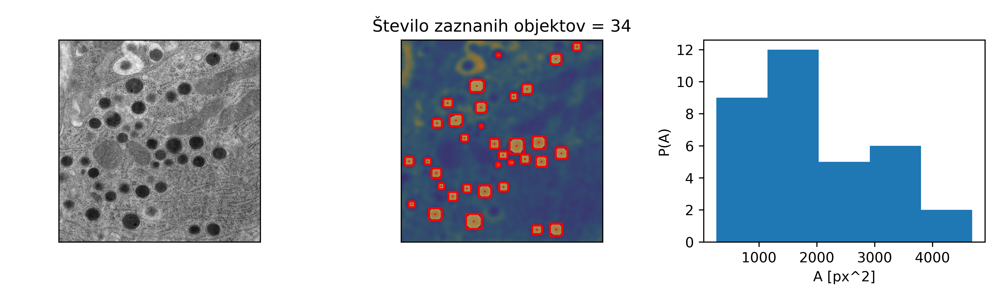

# Laboratorijski delovni list 10
## Segmentacija slik II: analiza eksperimentalne slike

Univerza v Mariboru · Fakulteta za naravoslovje in matematiko · Oddelek za fiziko

> [!IMPORTANT]
> **Programsko okolje: Python**
>
> Vse naloge rešujete **izključno v Pythonu** (virtualno okolje iz [vaje 00](../00_vaje/README.md)).
> - `opencv-python`: `cv2.imread`; `numpy`: `np.pad`, `np.mgrid`, `np.nonzero`, `np.isin`
> - `skimage.filters`: `gaussian`, `threshold_otsu`, `threshold_multiotsu`
> - `skimage.measure`: `label`, `regionprops`; `skimage.morphology`: `binary_erosion`, `binary_dilation`
> - `scipy.ndimage`: `binary_fill_holes`; `matplotlib`: `imshow`, `contour`, `patches.Rectangle`
>
> Rešitev oddate kot Jupyter zvezek `.ipynb` z izvedenimi celicami.

PDF različica: [navodila/delovni_list_10.pdf](navodila/delovni_list_10.pdf)

---

## 1. Teoretične osnove in motivacija

Na vaji 9 smo segmentirali umetne slike z jasno ločenim ospredjem in ozadjem. Eksperimentalne slike so zahtevnejše: vsebujejo šum, neenakomerno osvetlitev in strukture, ki jih ne želimo zajeti. Danes analiziramo posnetek elektronskega mikroskopa (`Kontrola.tif`), na katerem so temna okrogla zrnca. Sestavili bomo postopek, ki zrnca zanesljivo zazna, in izmerili njihovo velikost in obliko.

> **Opis modela**
>
> Postopek segmentacije: (1) glajenje z Gaussovim filtrom, (2) prag po Otsujevi metodi, (3) zapolnitev lukenj, (4) morfološko odpiranje, (5) označevanje povezanih območij in odstranitev premajhnih, (6) meritve lastnosti objektov. Preverimo tudi, kako je rezultat odvisen od izbire parametrov.

<!-- w=0.95 -->


### Glajenje

Šum v sliki povzroči, da prag razbije objekte na veliko drobnih območij. Sliko zato najprej zgladimo s konvolucijo z Gaussovim jedrom

$$
G_\sigma(x, y) = \frac{1}{2\pi\sigma^2}\, e^{-(x^2+y^2)/2\sigma^2},
$$

kjer $\sigma$ (v pikslih) določa, kako močno zgladimo. Premajhen $\sigma$ ne odpravi šuma, prevelik pa zabriše robove in združi bližnje objekte.

### Otsujeva metoda z več razredi

Na sliki so poleg temnih zrnc še srednje sive strukture (mitohondriji, membrane) in svetlo ozadje. Navadna Otsujeva metoda sliko razdeli v dva razreda in zrnca združi s sivimi strukturami. **Otsujeva metoda s tremi razredi** poišče dva praga $T_1 < T_2$, ki maksimizirata varianco med tremi razredi. Za zrnca vzamemo piksle pod spodnjim pragom $T_1$.

### Matematična morfologija

Binarno masko $M$ obdelamo s **strukturnim elementom** $E$ (npr. diskom s polmerom $r$):

$$
M \oplus E = \bigcup_{\mathbf e \in E} (M + \mathbf e) \quad \text{(dilatacija)}, \qquad M \ominus E = \bigcap_{\mathbf e \in E} (M - \mathbf e) \quad \text{(erozija)}.
$$

Dilatacija objekte razširi in zapolni majhne vrzeli, erozija jih skrči in odstrani drobne izbokline. Sestavljeni operaciji sta **odpiranje** $(M \ominus E) \oplus E$, ki odstrani objekte, manjše od elementa, in loči tanko povezane objekte, ter **zapiranje** $(M \oplus E) \ominus E$, ki zapolni majhne luknje in reže. Obe operaciji izvedemo z zamiki maske: za vsak piksel elementa masko premaknemo in rezultate združimo z logičnim ALI (dilatacija) oziroma IN (erozija).

### Meritve objektov

Za vsak objekt z `skimage.measure.regionprops` izračunamo ploščino $A$, obseg $P$, težišče, očrtani pravokotnik in ekscentričnost. Iz njih izpeljemo

$$
d_{\rm ekv} = \sqrt{\frac{4A}{\pi}}, \qquad o = \frac{4\pi A}{P^2},
$$

kjer je $d_{\rm ekv}$ premer kroga z enako ploščino, $o$ pa **okroglost** (1 za krog, manj za podolgovate ali razvejane oblike).

---

## 2. Pripravljalna naloga (analitični del)

**P1. Gaussovo glajenje.** Kolikšna je širina na polovični višini (FWHM) Gaussovega jedra z $\sigma = 5$ px? Koliko pikslov nekega objekta s premerom 10 px po glajenju z $\sigma = 10$ px še ostane pod pragom, ki leži na polovici med sivino objekta in ozadja (kvalitativno)?

FWHM $=$ `__________`  odgovor: `____________________`

**P2. Erozija in dilatacija.** Maska je kvadrat $3 \times 3$ pikslov sredi prazne slike. Strukturni element je križ (disk z $r = 1$). Narišite rezultat erozije in dilatacije ter preštejte piksle. Kaj vrneta odpiranje in zapiranje?

erozija: `______`  dilatacija: `______`  odpiranje: `______`  zapiranje: `______`

**P3. Strukturni element.** Koliko pikslov ima disk s polmerom $r = 3$ (pogoj $x^2 + y^2 \le r^2$)? Kateri objekti izginejo pri odpiranju s tem elementom?

število pikslov: `______`  `______________________________`

**P4. Okroglost.** Izračunajte okroglost kroga, kvadrata in pravokotnika z razmerjem stranic $1:4$. Zakaj je okroglost diskretnega kroga, izmerjena na sliki, manjša od 1?

krog: `______`  kvadrat: `______`  pravokotnik: `______`

---

## 3. Laboratorijske naloge na računalniku (Python)

> **Repozitorij**
>
> Začetna predloga je v repozitoriju predmeta: [`10_vaje/vaje_10.ipynb`](vaje_10.ipynb). Slika `Kontrola.tif` je v mapi [`09_vaje/navodila/Gradivo/`](../09_vaje/navodila/Gradivo/). V razdelku *Funkcije* dopolnite telesa funkcij z oznako `TODO`, v razdelku *Testno območje* pa preverite rezultata nalog P2 in P4.

### Naloga 1: Glajenje in prag (20 min)

1. Naložite sliko, izpišite njeno velikost in podatkovni tip ter narišite histogram sivin.
2. Dopolnite funkcijo `prag(img_f, razredi)`, ki vrne Otsujev prag za dva razreda ali spodnji prag za tri razrede.
3. Za $\sigma \in \{0, 2, 5, 10\}$ izračunajte oba praga in število povezanih območij pod pragom. **Slika 2**: histogram in maske za tri razrede.

| $\sigma$ [px] | $T$ (2 razreda) | območij (2 razreda) | $T_1$ (3 razredi) | območij (3 razredi) |
|---|---|---|---|---|
| 0 | `______` | `______` | `______` | `______` |
| 2 | `______` | `______` | `______` | `______` |
| 5 | `______` | `______` | `______` | `______` |
| 10 | `______` | `______` | `______` | `______` |

*Preglednica 1: Vpliv glajenja in števila razredov na prag in število območij.*

### Naloga 2: Morfološke operacije (25 min)

1. Dopolnite funkcije `element_disk(r)`, `dilatacija(M, E)`, `erozija(M, E)`, `odpiranje` in `zapiranje`. Pri eroziji je zunaj slike ospredje (`np.pad(..., constant_values=True)`), sicer bi objekti ob robu izgubili piksle.
2. Preverite P2 in primerjajte rezultate s funkcijama `skimage.morphology.binary_erosion` in `binary_dilation`.
3. Na izrezu maske (vrstice 150–300, stolpci 300–450, $\sigma = 2$, dva razreda) izvedite vse štiri operacije z diskom $r = 3$. **Slika 3**: maska in rezultati operacij.

```python
for di, dj in zip(*np.nonzero(E)):          # vsi piksli strukturnega elementa
    out |= P[di:di + H, dj:dj + W]           # dilatacija (pri eroziji: &=)
```

| Operacija | maska | erozija | dilatacija | odpiranje | zapiranje |
|---|---|---|---|---|---|
| število pikslov | `______` | `______` | `______` | `______` | `______` |
| število območij | `______` | `______` | `______` | `______` | `______` |

*Preglednica 2: Morfološke operacije na izrezu slike (disk $r = 3$).*

### Naloga 3: Segmentacija zrnc (25 min)

1. Dopolnite funkcijo `segmentiraj(img, sigma, r, A_min, razredi)`, ki izvede celoten postopek in vrne oznake ter seznam regij (`regionprops`).
2. Segmentirajte sliko s $\sigma = 5$, $r = 3$, $A_{\min} = 100$ px in tremi razredi. Za primerjavo postopek ponovite z dvema razredoma in preštejte objekte z okroglostjo pod $0{,}5$.
3. **Slika 4**: slika z obrisi objektov (`contour`), težišči in očrtanimi pravokotniki.

| Objekt (po ploščini) | $A$ [px] | $d_{\rm ekv}$ [px] | okroglost | ekscentričnost |
|---|---|---|---|---|
| 1 | `______` | `______` | `______` | `______` |
| 2 | `______` | `______` | `______` | `______` |
| 3 | `______` | `______` | `______` | `______` |

*Preglednica 3: Lastnosti treh največjih zrnc. Število objektov: 3 razredi `______`, 2 razreda `______` (od tega z okroglostjo $< 0{,}5$: `______`).*

### Naloga 4: Porazdelitve in občutljivost (20 min)

1. **Slika 5**: histograma ekvivalentnega premera in okroglosti zaznanih zrnc. Izračunajte povprečji in standardna odklona.
2. Segmentacijo ponovite za $\sigma \in \{3, 5, 8\}$ in $A_{\min} \in \{50, 100, 400\}$ px ter preštejte objekte.

| $\sigma$ \ $A_{\min}$ | 50 px | 100 px | 400 px |
|---|---|---|---|
| 3 | `______` | `______` | `______` |
| 5 | `______` | `______` | `______` |
| 8 | `______` | `______` | `______` |

*Preglednica 4: Število zaznanih zrnc v odvisnosti od parametrov. Pri $\sigma = 5$, $A_{\min} = 100$ px: $\langle d_{\rm ekv}\rangle =$ `______`, $\langle o\rangle =$ `______`.*

---

## 4. Vprašanja za razpravo in zaključni zagovor

> **Razmislek 1: Izbira parametrov**
>
> Kateri parameter najbolj vpliva na število zaznanih zrnc? Kako bi parametre izbrali objektivno, na primer s primerjavo z ročno označeno sliko? Zakaj je »pravilno« število zrnc na tej sliki težko določiti?

> **Razmislek 2: Dva ali trije razredi**
>
> Zakaj Otsujeva metoda z dvema razredoma zajame tudi sive strukture? Kako to vidimo v okroglosti objektov? Kdaj bi namesto globalnega praga uporabili lokalni (prilagodljivi) prag?

> **Razmislek 3: Sklenjeni in robni objekti**
>
> Kaj se zgodi z zrnci, ki se dotikajo? Kako bi jih ločili (npr. z razdaljno transformacijo in metodo razvodnice)? Ali bi morali zrnca, ki jih seka rob slike, izključiti iz statistike velikosti? Zakaj?

> **Razmislek 4: Fizikalne enote (domača naloga)**
>
> Elektronski mikroskopi v metapodatkih slike TIFF pogosto zapišejo velikost piksla (opozorilo OpenCV o neznani oznaki 33560 kaže, da so dodatni podatki v datoteki). Recimo, da je piksel velik 2 nm. Izrazite povprečni premer zrnc v nanometrih in ocenite njihovo prostornino ob predpostavki, da so kroglasta.

---

### Dodatno gradivo

- [`resitve/vaje_10_resitev.ipynb`](resitve/vaje_10_resitev.ipynb): rešitev z izvedenimi celicami
- [`navodila/segmentacija_slike.png`](navodila/segmentacija_slike.png): rezultat analize iz preteklih let
- Izvorna slika: [`../09_vaje/navodila/Gradivo/Kontrola.tif`](../09_vaje/navodila/Gradivo/Kontrola.tif)
