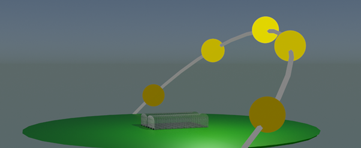

# Laboratorijski delovni list 11
## Sonce na nebu: lega Sonca, dolžina dneva in obsevanje

Univerza v Mariboru · Fakulteta za naravoslovje in matematiko · Oddelek za fiziko

> [!IMPORTANT]
> **Programsko okolje: Python**
>
> Vse naloge rešujete **izključno v Pythonu** (virtualno okolje iz [vaje 00](../00_vaje/README.md)).
> - `numpy`: `np.sin`, `np.arcsin`, `np.arccos`, `np.deg2rad`, `np.where`, `np.clip`
> - `pandas`: `pd.read_csv`, `pd.to_datetime`, `groupby`
> - `astropy`: `EarthLocation`, `AltAz`, `get_sun`, `Time` (referenčni izračun)
> - `matplotlib.pyplot`: `plot`, polarni graf (`projection="polar"`)
>
> Rešitev oddate kot Jupyter zvezek `.ipynb` z izvedenimi celicami.

PDF različica: [navodila/delovni_list_11.pdf](navodila/delovni_list_11.pdf)

---

## 1. Teoretične osnove in motivacija

Na tej in naslednji vaji sestavimo model energijske bilance plastenjaka. Prvi korak je natančno poznavanje vira energije: kje na nebu je Sonce ob danem času, kako dolg je dan in koliko sončne energije prejme ploskev. Danes zapišemo analitični model lege Sonca, ga primerjamo z natančnim astronomskim izračunom (knjižnica `astropy`) in z modelom obsevanja v jasnem vremenu ocenimo, koliko energije prejme vodoravna ploskev v Mariboru skozi leto.

> **Opis modela**
>
> Lokacija je FNM v Mariboru ($\varphi = 46{,}56°$ s. g. š., $\lambda = 15{,}64°$ v. g. d.). Lego Sonca opišemo z višino nad obzorjem $\alpha$ in azimutom $A$ (merjenim od severa v smeri urinega kazalca). Obe količini sta odvisni od dneva v letu $n$ in časa $t$.

<!-- w=0.55 -->


### Deklinacija in časovna enačba

Os vrtenja Zemlje je nagnjena za $23{,}44°$, zato se **deklinacija** Sonca $\delta$ skozi leto spreminja. V približku (Cooper, 1969):

$$
\delta(n) = 23{,}44°\,\sin\!\left(\frac{2\pi(284 + n)}{365}\right).
$$

Ker je tir Zemlje eliptičen in os nagnjena, Sonce ne doseže najvišje točke vsak dan ob istem času. Razliko med pravim in srednjim sončnim časom opisuje **časovna enačba**

$$
E(n) = 9{,}87\sin 2B - 7{,}53\cos B - 1{,}5\sin B\ \ [\mathrm{min}], \qquad B = \frac{2\pi(n - 81)}{364}.
$$

### Urni kot, višina in azimut

Pravi sončni čas je $t_s = t_{\rm UTC} + \lambda/15° + E/60$ (v urah), **urni kot** pa $H = 15°\,(t_s - 12)$. Višina in azimut Sonca sta

$$
\sin\alpha = \sin\varphi\sin\delta + \cos\varphi\cos\delta\cos H, \qquad \cos A = \frac{\sin\delta - \sin\alpha\sin\varphi}{\cos\alpha\cos\varphi},
$$

pri čemer popoldne ($H > 0$) vzamemo $A \to 360° - A$. Opoldne je $\alpha_{\max} = 90° - \varphi + \delta$.

### Dolžina dneva

Ob vzhodu in zahodu je $\alpha = 0$, zato je urni kot vzhoda $\cos H_0 = -\tan\varphi\tan\delta$ in

$$
T_{\rm dan} = \frac{2H_0}{15°}\ \mathrm{h}, \qquad t_{\rm vzhod,\,zahod} = 12 - \frac{\lambda}{15°} - \frac{E}{60} \mp \frac{H_0}{15°}\ \ [\mathrm{h,\ UTC}].
$$

### Obsevanje v jasnem vremenu

Sončna svetloba na poti skozi ozračje oslabi. Pot opišemo z **relativno zračno maso** (Kasten in Young, 1989)

$$
AM = \frac{1}{\sin\alpha + 0{,}50572\,(\alpha + 6{,}07995°)^{-1{,}6364}},
$$

direktno obsevanje pravokotne ploskve pa ocenimo z empiričnim modelom (Meinel) $I_D = S_0'\,0{,}7^{AM^{0{,}678}}$, kjer je $S_0' = S_0[1 + 0{,}033\cos(2\pi n/365)]$ in $S_0 = 1361\ \mathrm{W/m^2}$. Z razpršeno svetlobo je globalno obsevanje približno $1{,}1\,I_D$, na vodoravno ploskev pa pade

$$
I_h = 1{,}1\,I_D\,\sin\alpha .
$$

Razmerje med izmerjeno in modelsko dnevno energijo imenujemo **indeks jasnosti**; pove, kolikšen del energije jasnega neba v povprečju doseže tla.

---

## 2. Pripravljalna naloga (analitični del)

**P1. Deklinacija in višina Sonca.** Izračunajte $\delta$ in $\alpha_{\max}$ v Mariboru ob poletnem in zimskem solsticiju ter ob enakonočju.

| | 21. 3. ($n = 80$) | 21. 6. ($n = 172$) | 21. 12. ($n = 355$) |
|---|---|---|---|
| $\delta$ | `______` | `______` | `______` |
| $\alpha_{\max}$ | `______` | `______` | `______` |
| $T_{\rm dan}$ | `______` | `______` | `______` |

*Preglednica P1: Lega Sonca v Mariboru.*

**P2. Dolžina dneva.** Izpeljite $\cos H_0 = -\tan\varphi\tan\delta$. Na kateri geografski širini Sonce ob poletnem solsticiju ne zaide? Kolikšna je dolžina dneva na ekvatorju?

meja polarnega dne: `__________`  ekvator: `__________`

**P3. Sončni poldan.** Ob kateri uri (UTC in CET) je pravi sončni poldan v Mariboru 21. 3., ko je $E \approx -7{,}8$ min?

UTC: `__________`  CET: `__________`

**P4. Zračna masa.** Izračunajte $AM$ in $I_D$ pri višini Sonca $90°$, $30°$ in $10°$ ($S_0' = S_0$). Za koliko odstotkov oslabi direktna svetloba pri $\alpha = 10°$ glede na zenit?

| $\alpha$ | $90°$ | $30°$ | $10°$ |
|---|---|---|---|
| $AM$ | `______` | `______` | `______` |
| $I_D$ [W/m²] | `______` | `______` | `______` |

*Preglednica P4: Zračna masa in direktno obsevanje.*

---

## 3. Laboratorijske naloge na računalniku (Python)

> **Repozitorij**
>
> Začetna predloga je v repozitoriju predmeta: [`11_vaje/vaje_11.ipynb`](vaje_11.ipynb), podatki pa v mapi [`11_vaje/navodila/`](navodila/): `solar_daily.csv` (vzhod, zahod, dolžina dneva in največja višina Sonca za vsak dan leta 2023, izračunano z `astropy`) in `Vreme_urni.csv` (urna temperatura `T` in globalno obsevanje vodoravne ploskve `J` v W/m² za leto 2021). V razdelku *Funkcije* dopolnite telesa funkcij z oznako `TODO`, v razdelku *Testno območje* pa preverite rezultate nalog P1 in P4.

### Naloga 1: Dolžina dneva skozi leto (20 min)

1. Dopolnite funkcije `deklinacija(n)`, `urni_kot`, `visina`, `azimut` in `dolzina_dneva`.
2. Za vse dni leta izračunajte dolžino dneva in $\alpha_{\max}$ ter ju primerjajte s podatki v `solar_daily.csv`.
3. **Slika 2** (dva panela): (A) dolžina dneva iz modela in iz podatkov, (B) razlika model − astropy za dolžino dneva (v minutah) in $\alpha_{\max}$ (v stopinjah).

| $n$ | $T_{\rm dan}$ (m) [h] | $T_{\rm dan}$ (a) [h] | $\alpha_{\max}$ (m) | $\alpha_{\max}$ (a) | vzhod (m) [UTC] | vzhod (a) [UTC] |
|---|---|---|---|---|---|---|
| 1 | `____` | `____` | `____` | `____` | `____` | `____` |
| 80 | `____` | `____` | `____` | `____` | `____` | `____` |
| 172 | `____` | `____` | `____` | `____` | `____` | `____` |
| 355 | `____` | `____` | `____` | `____` | `____` | `____` |

*Preglednica 1: Primerjava analitičnega modela (m) s podatki, izračunanimi z astropy (a).*

### Naloga 2: Pot Sonca čez dan (20 min)

Za 21. 3., 21. 6. in 21. 12. izračunajte $\alpha(t)$ in $A(t)$ s korakom 10 min. **Slika 3** (dva panela): (A) $\alpha(t)$ za vse tri dni, (B) pot Sonca v polarnem grafu (kot = azimut, sever zgoraj, polmer = $90° - \alpha$).

```python
ax = fig.add_subplot(122, projection="polar")
ax.set_theta_zero_location("N")      # sever zgoraj
ax.set_theta_direction(-1)           # azimut v smeri urinega kazalca
```

| Datum | azimut vzhoda | azimut zahoda | $\alpha_{\max}$ | ura $\alpha_{\max}$ [UTC] |
|---|---|---|---|---|
| 21. 3. | `______` | `______` | `______` | `______` |
| 21. 6. | `______` | `______` | `______` | `______` |
| 21. 12. | `______` | `______` | `______` | `______` |

*Preglednica 2: Pot Sonca ob solsticijih in enakonočju.*

### Naloga 3: Primerjava z astropy (20 min)

Funkcija `astropy_lega(datum)` vrne višino in azimut Sonca iz natančnega astronomskega izračuna. Za vse tri dni izračunajte razliki $\Delta\alpha$ in $\Delta A$ med modelom in `astropy`, ko je Sonce nad obzorjem. **Slika 4**: $\Delta\alpha(t)$ in $\Delta A(t)$.

| Datum | največja $\lvert\Delta\alpha\rvert$ | največja $\lvert\Delta A\rvert$ | $\alpha_{\max}$ (astropy) |
|---|---|---|---|
| 21. 3. | `______` | `______` | `______` |
| 21. 6. | `______` | `______` | `______` |
| 21. 12. | `______` | `______` | `______` |

*Preglednica 3: Natančnost analitičnega modela.*

### Naloga 4: Obsevanje skozi leto (30 min)

1. Dopolnite funkciji `zracna_masa(alt)` in `obsevanje_jasno(alt, n)`.
2. Za vsak dan leta izračunajte energijo, ki jo v jasnem vremenu prejme vodoravna ploskev (integral $I_h$ čez dan, korak 10 min), v kWh/m².
3. Iz `Vreme_urni.csv` izračunajte izmerjeno dnevno energijo (vsota urnih vrednosti $J$) in mesečne indekse jasnosti.
4. **Slika 5**: izmerjena in modelska dnevna energija skozi leto.

| Mesec | jan | mar | jun | sep | dec | leto |
|---|---|---|---|---|---|---|
| jasno nebo [kWh/m² na dan] | `____` | `____` | `____` | `____` | `____` | `____` |
| izmerjeno [kWh/m² na dan] | `____` | `____` | `____` | `____` | `____` | `____` |
| indeks jasnosti | `____` | `____` | `____` | `____` | `____` | `____` |

*Preglednica 4: Obsevanje vodoravne ploskve v Mariboru (stolpec »leto«: letna vsota v kWh/m²).*

---

## 4. Vprašanja za razpravo in zaključni zagovor

> **Razmislek 1: Natančnost modela**
>
> Zakaj je razlika med modelom in `astropy` največja ob enakonočju? Kateri del modela je najmanj natančen? Ali je natančnost $0{,}5°$ zadostna za izračun obsevanja plastenjaka?

> **Razmislek 2: Vzhod in zahod**
>
> Zakaj najzgodnejši sončni vzhod ni na dan poletnega solsticija in najkasnejši ne na dan zimskega? Kakšno vlogo ima časovna enačba? Kako bi v modelu upoštevali lom svetlobe v ozračju in velikost sončne ploskvice?

> **Razmislek 3: Ozračje in oblaki**
>
> Zakaj je indeks jasnosti pozimi manjši kot spomladi in jeseni? Katere poenostavitve modela obsevanja v jasnem vremenu lahko vplivajo na izračunani indeks? Kako bi model izboljšali z izmerjenimi podatki o oblačnosti?

> **Razmislek 4: Sončna elektrarna (domača naloga)**
>
> Na strehi z vodoravno površino 50 m² je sončna elektrarna z izkoristkom 20 %. Iz izmerjenih podatkov izračunajte, koliko električne energije proizvede vsak mesec. Koliko kilometrov bi z njo prevozili z električnim avtomobilom, ki porabi 15 kWh na 100 km? Ali bi pokrila porabo gospodinjstva s 30 kWh na dan?

---

### Dodatno gradivo

- [`resitve/vaje_11_resitev.ipynb`](resitve/vaje_11_resitev.ipynb): rešitev z izvedenimi celicami
- Podatki v mapi [`navodila/`](navodila/), ki jih uporabljajo zvezki:
  - [`solar_daily.csv`](navodila/solar_daily.csv): za vsak dan leta 2023 azimut in ura vzhoda ter zahoda Sonca, dolžina dneva [h] in največja višina Sonca [°] (izračunano z `astropy`); vaja 11
  - [`Vreme_urni.csv`](navodila/Vreme_urni.csv): urna temperatura zraka `T` [°C] in globalno obsevanje vodoravne ploskve `J` [W/m²], Maribor 2021; vaje 11, 12 in 15
- Dodatni podatki, ki jih zvezki ne uporabljajo (za lastne analize in domače naloge):
  - [`vreme.csv`](navodila/vreme.csv): polurne meritve za leto 2021 s temperaturo `T` [°C], relativno vlažnostjo `H` [%] in obsevanjem `J` [W/m²]; `Vreme_urni.csv` je njeno urno povprečje (brez vlažnosti)
  - [`solar_hourly.csv`](navodila/solar_hourly.csv): višina `alt` in azimut `az` Sonca [°] za leto 2023; kljub imenu podatki niso urni, ampak večinoma na 10 min (januarja deloma na 1 min)
  - [`df_dt.xlsx`](navodila/df_dt.xlsx): urna višina in azimut Sonca za leto 2025
  - [`df_day.xlsx`](navodila/df_day.xlsx): dnevni podatki za leto 2025 (največja višina, azimut in ura vzhoda ter zahoda, dolžina dneva v s; uri sta zaokroženi na celo uro)
  - [`solar_daily_08_12_2025.csv`](navodila/solar_daily_08_12_2025.csv) in [`solar_temp_08_12_2025.csv`](navodila/solar_temp_08_12_2025.csv): ponovni izračun z dne 8. 12. 2025, ki se od `solar_daily.csv` oziroma `solar_hourly.csv` razlikuje le na ravni zaokrožitvenih napak ($10^{-13}$)
- Slike [`Slika1.png`](navodila/Slika1.png)–[`Slika3.png`](navodila/Slika3.png): pot Sonca na nebu in shema toplotnih tokov v plastenjaku (vaja 12)
- Datoteka `navodila/solar_minute.csv` (minutna lega Sonca za leto 2023, 38 MB) je zaradi velikosti izključena iz gita.
