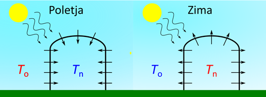

# Laboratorijski delovni list 12
## Energijska bilanca plastenjaka: obsevanje, segrevanje in gretje

Univerza v Mariboru · Fakulteta za naravoslovje in matematiko · Oddelek za fiziko

> [!IMPORTANT]
> **Programsko okolje: Python**
>
> Vse naloge rešujete **izključno v Pythonu** (virtualno okolje iz [vaje 00](../00_vaje/README.md)).
> - `numpy`: `np.sin`, `np.cos`, `np.where`, `np.exp`, `np.maximum`
> - `pandas`: `pd.read_csv`, `pd.to_datetime`, `groupby`, `clip`
> - `matplotlib.pyplot`: `plot`, `bar`
>
> Rešitev oddate kot Jupyter zvezek `.ipynb` z izvedenimi celicami.

PDF različica: [navodila/delovni_list_12.pdf](navodila/delovni_list_12.pdf)

---

## 1. Teoretične osnove in motivacija

Plastenjak omogoča gojenje rastlin tudi takrat, ko je zunaj prehladno. Podnevi ga ogreva Sonce, ponoči in pozimi pa toploto izgublja skozi folijo, zato ga je treba ogrevati. Na tej vaji model lege Sonca in obsevanja z vaje 11 povežemo z merjenimi vremenskimi podatki in sestavimo model toplotne bilance plastenjaka. Z njim ocenimo temperaturo v plastenjaku skozi leto in energijo, potrebno za ogrevanje.

> **Opis modela**
>
> Plastenjak v Mariboru ima dolžino $a = 20$ m (os sever-jug), širino $b = 5$ m in višino $h = 3$ m. Skozi štiri stene in streho prejema sončno energijo, skozi folijo pa izmenjuje toploto z okolico. Zrak in vrhnja plast tal (10 cm) imata skupno toplotno kapaciteto $C$. Uporabimo urne meritve zunanje temperature in obsevanja za leto 2021.

<!-- w=0.6 -->

### Obsevanje nagnjene ploskve

Ploskev z naklonom $\beta$ (0° vodoravna, 90° navpična) in azimutom $\gamma$ (smer normale, merjena od severa) prejme direktne žarke pod vpadnim kotom $\theta$, za katerega velja

$$
\cos\theta = \sin\alpha\cos\beta + \cos\alpha\sin\beta\cos(A - \gamma),
$$

kjer sta $\alpha$ in $A$ višina in azimut Sonca. Negativna vrednost pomeni, da je ploskev v senci ($\cos\theta \to 0$). Skupaj z razpršeno svetlobo je obsevanje ploskve v jasnem vremenu

$$
I_\beta = I_D\cos\theta + 0{,}1\,I_D\sin\alpha\,\frac{1 + \cos\beta}{2},
$$

kar za vodoravno ploskev da $I_h = 1{,}1\,I_D\sin\alpha$ kot na vaji 11. Vpliv oblakov upoštevamo z dnevnim **indeksom jasnosti** $K = \sum J / \sum I_h$, kjer je $J$ izmerjeno obsevanje vodoravne ploskve. Sončna moč, ki vstopi v plastenjak, je

$$
P_s(t) = \tau\,K\sum_{i} S_i\,I_{\beta_i}(t),
$$

kjer je $\tau$ prepustnost folije, $S_i$ pa površine ploskev.

### Toplotna bilanca

Temperatura v plastenjaku $T$ se spreminja zaradi sončnega dotoka, toplotnih izgub skozi ovoj s površino $S$ in toplotno prehodnostjo $U$ ter morebitnega gretja $P_g$:

$$
C\,\frac{\mathrm{d}T}{\mathrm{d}t} = P_s - US\,(T - T_z) + P_g .
$$

Enojna folija ima $U \approx 6\ \mathrm{W/(m^2K)}$, dvojna z zračno blazino $U \approx 3{,}5\ \mathrm{W/(m^2K)}$. Brez gretja temperatura s časovno konstanto $\tau_T = C/(US)$ relaksira k ravnovesni vrednosti $T_r = T_z + P_s/(US)$.

### Numerično reševanje

Podatki so urni ($\Delta t = 1$ h). Eksplicitna Eulerjeva metoda da

$$
T_{k+1} = T_k + \frac{\Delta t}{C}\left[P_s - US(T_k - T_z)\right] \quad\Rightarrow\quad T_{k+1} - T_r = \left(1 - \frac{\Delta t}{\tau_T}\right)(T_k - T_r),
$$

kar je stabilno le za $\Delta t < 2\tau_T$. Ker sta $T_z$ in $P_s$ znotraj ure približno konstantna, lahko uporabimo kar **točno rešitev** v koraku:

$$
T_{k+1} = T_r + (T_k - T_r)\,e^{-\Delta t/\tau_T}.
$$

Gretje modeliramo s termostatom: če bi temperatura padla pod $T_{\min}$, grelec dovede energijo $C\,(T_{\min} - T_{k+1})$ in temperatura ostane $T_{\min}$.

> **Predpostavke o podatkih**
>
> Datoteka [`11_vaje/navodila/Vreme_urni.csv`](../11_vaje/navodila/Vreme_urni.csv) vsebuje urne vrednosti temperature `T` [°C] in globalnega obsevanja vodoravne ploskve `J` [W/m²]. Čas je srednjeevropski (UTC+1), vrednost pa je povprečje ure, ki se začne ob navedenem času. Lego Sonca zato računamo ob času $t_{\rm UTC} = t + 0{,}5 - 1$ h.

---

## 2. Pripravljalna naloga (analitični del)

**P1. Vpadni kot.** Izračunajte $\cos\theta$ za vse štiri stene in streho opoldne 21. 6. ($\alpha = 66{,}9°$, $A = 180°$) in 21. 12. ($\alpha = 20{,}0°$, $A = 180°$). Katera ploskev prejme največ energije pozimi?

| | sever | vzhod | jug | zahod | streha |
|---|---|---|---|---|---|
| 21. 6. | `____` | `____` | `____` | `____` | `____` |
| 21. 12. | `____` | `____` | `____` | `____` | `____` |

*Preglednica P1: Kosinus vpadnega kota opoldne.*

**P2. Časovna konstanta.** Izračunajte površino ovoja $S$, toplotno kapaciteto $C$ (zrak: $\rho = 1{,}2\ \mathrm{kg/m^3}$, $c = 1005$ J/(kg K); tla: 10 cm, $2{,}0\ \mathrm{MJ/(m^3 K)}$), $US$ za enojno folijo in $\tau_T$. Za koliko se plastenjak v ravnovesju segreje nad okolico pri sončni moči 20 kW?

$S=$ `______`  $C=$ `______`  $US=$ `______`  $\tau_T=$ `______`  $\Delta T=$ `______`

**P3. Stabilnost Eulerjeve metode.** Pokažite, da je Eulerjeva metoda stabilna za $\Delta t < 2\tau_T$. Kolikšna bi bila $\tau_T$, če bi upoštevali le toplotno kapaciteto zraka? Ali bi bila tedaj Eulerjeva metoda z $\Delta t = 1$ h uporabna?

$\tau_T$ (samo zrak) $=$ `__________`  odgovor: `______________`

**P4. Ocena gretja.** Ocenite energijo za gretje plastenjaka z enojno folijo v januarju (31 dni), če je povprečna zunanja temperatura $0$ °C, želena notranja $10$ °C in sončni dotok zanemarimo.

$Q_{\rm jan}\approx$ `__________`

---

## 3. Laboratorijske naloge na računalniku (Python)

> **Repozitorij**
>
> Začetna predloga je v repozitoriju predmeta: [`12_vaje/vaje_12.ipynb`](vaje_12.ipynb). Model lege Sonca in direktnega obsevanja z vaje 11 je že vnesen. V razdelku *Funkcije* dopolnite telesa funkcij z oznako `TODO`, v razdelku *Testno območje* pa preverite rezultata nalog P1 in P2.

### Naloga 1: Obsevanje ploskev čez dan (20 min)

1. Dopolnite funkciji `cos_vpadni(alt, A, beta, gama)` in `obsevanje_ploskve(alt, A, n, beta, gama)`.
2. **Slika 2** (dva panela): obsevanje vseh petih ploskev čez dan 21. 6. in 21. 12. (korak 10 min). Izračunajte dnevno energijo na kvadratni meter posamezne ploskve.

| Ploskev | sever | vzhod | jug | zahod | streha |
|---|---|---|---|---|---|
| 21. 6. [kWh/m²] | `____` | `____` | `____` | `____` | `____` |
| 21. 12. [kWh/m²] | `____` | `____` | `____` | `____` | `____` |

*Preglednica 1: Dnevna energija na enoto površine v jasnem vremenu.*

### Naloga 2: Sončni dotok skozi leto (20 min)

1. Za vse ure leta izračunajte lego Sonca, modelsko obsevanje vodoravne ploskve in dnevni indeks jasnosti $K$ iz meritev (omejite ga na $[0;\ 1{,}2]$).
2. Izračunajte urno sončno moč, ki pade na ovoj plastenjaka, $P(t) = K\sum_i S_i I_{\beta_i}$, in mesečno energijo za vsako ploskev.

| Ploskev | sever | vzhod | jug | zahod | streha |
|---|---|---|---|---|---|
| januar [kWh] | `____` | `____` | `____` | `____` | `____` |
| junij [kWh] | `____` | `____` | `____` | `____` | `____` |
| leto [MWh] | `____` | `____` | `____` | `____` | `____` |

*Preglednica 2: Sončna energija, ki pade na posamezne ploskve plastenjaka.*

### Naloga 3: Temperatura brez gretja (25 min)

1. Dopolnite funkciji `korak_euler` in `korak_tocen` ter zanko v funkciji `simulacija`.
2. Simulirajte temperaturo v plastenjaku ($U = 6\ \mathrm{W/(m^2K)}$, $\tau = 0{,}8$) brez gretja za prvih 10 dni januarja in julija, z obema metodama.
3. **Slika 3** (dva panela): zunanja temperatura in notranja temperatura po obeh metodah.

| Obdobje | $T_z$ min–max | $T$ min–max | $\langle T - T_z\rangle$ | največja razlika Euler–točno |
|---|---|---|---|---|
| 1.–10. januar | `______` | `______` | `______` | `______` |
| 1.–10. julij | `______` | `______` | `______` | `______` |

*Preglednica 3: Temperatura v plastenjaku brez gretja.*

### Naloga 4: Gretje skozi leto (25 min)

1. Simulirajte celo leto s termostatom $T_{\min} = 10$ °C. **Slika 4** (dva panela): notranja in zunanja temperatura skozi leto ter mesečna energija za gretje.
2. Izračun ponovite za enojno ($U = 6$) in dvojno folijo ($U = 3{,}5$) s prepustnostjo $\tau = 0{,}7$ in $0{,}9$.

| $U$ [W/(m²K)] | $\tau$ | gretje [MWh/leto] | ur z gretjem | ur nad 35 °C | $T_{\max}$ [°C] |
|---|---|---|---|---|---|
| 6 | 0,7 | `______` | `______` | `______` | `______` |
| 6 | 0,9 | `______` | `______` | `______` | `______` |
| 3,5 | 0,7 | `______` | `______` | `______` | `______` |
| 3,5 | 0,9 | `______` | `______` | `______` | `______` |

*Preglednica 4: Letna energija za gretje plastenjaka ($T_{\min} = 10$ °C). Primerjava januarja s P4: `______`.*

---

## 4. Vprašanja za razpravo in zaključni zagovor

> **Razmislek 1: Usmerjenost plastenjaka**
>
> Zakaj vzhodna in zahodna stena skozi leto prejmeta precej več energije kot južna, čeprav je južna pozimi najbolj obsijana? Kako bi se letni sončni dotok spremenil, če bi plastenjak zasukali za 90°?

> **Razmislek 2: Pregrevanje**
>
> Model poleti napove temperature nad 70 °C. Kateri procesi, ki jih model ne vključuje, v resničnem plastenjaku omejujejo temperaturo (prezračevanje, izhlapevanje, senčenje)? Kako bi v enačbo dodali prezračevanje z $n$ izmenjavami zraka na uro?

> **Razmislek 3: Izolacija in svetloba**
>
> Dvojna folija močno zmanjša potrebo po gretju, a hkrati poveča pregrevanje. Zakaj? Kako bi izbrali $U$ in $\tau$, če plastenjak uporabljamo samo od marca do oktobra?

> **Razmislek 4: Sončna elektrarna in toplotna črpalka (domača naloga)**
>
> Gretje naj zagotavlja toplotna črpalka s grelnim številom 3. Koliko električne energije porabi v letu? Kolikšna bi morala biti površina sončne elektrarne z izkoristkom 20 %, da bi v letni bilanci pokrila to porabo? Zakaj letna bilanca ne pove vsega?

---

### Dodatno gradivo

- [`resitve/vaje_12_resitev.ipynb`](resitve/vaje_12_resitev.ipynb): rešitev z izvedenimi celicami
- [`navodila/Slika3.png`](navodila/Slika3.png): shema toplotnih tokov (kopija iz vaje 11)
- Podatki so v mapi [`../11_vaje/navodila/`](../11_vaje/navodila/)
