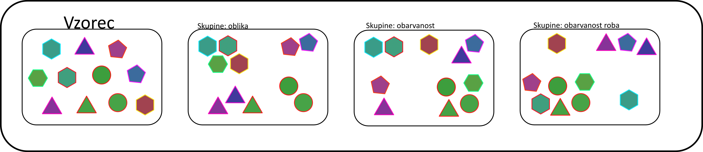

# Laboratorijski delovni list 14
## Grupiranje podatkov: mere podobnosti časovnih vrst (dodatna vaja)

Univerza v Mariboru · Fakulteta za naravoslovje in matematiko · Oddelek za fiziko

> [!IMPORTANT]
> **Programsko okolje: Python**
>
> Vse naloge rešujete **izključno v Pythonu** (virtualno okolje iz [vaje 00](../00_vaje/README.md)).
> - `numpy`: `np.fft.rfft`, `np.linalg.norm`, `np.bincount`, `np.argsort`
> - `scipy.cluster.hierarchy`: `linkage`, `fcluster`, `dendrogram`; `scipy.spatial.distance`: `squareform`
> - `matplotlib.pyplot`: `plot`, `imshow`
>
> Rešitev oddate kot Jupyter zvezek `.ipynb` z izvedenimi celicami.

PDF različica: [navodila/delovni_list_14.pdf](navodila/delovni_list_14.pdf)

---

## 1. Teoretične osnove in motivacija

Pri analizi meritev pogosto želimo podatke razdeliti v bolj homogene skupine, ne da bi vnaprej poznali njihove oznake: signale senzorjev glede na vrsto dogodka, zvezde glede na spremenljivost sija, celice glede na dinamiko kalcijevih nihanj. Ključna odločitev pri takem **grupiranju** (angl. *clustering*) je izbira **mere podobnosti**: kdaj sta si dve časovni vrsti »podobni«? Na tej vaji primerjamo štiri mere na umetnih časovnih vrstah, katerih pravo pripadnost skupinam poznamo.

> **Opis modela**
>
> Generiramo $N = 24$ sinusnih časovnih vrst dolžine $T = 100$ v $K = 4$ skupinah. Vrste v isti skupini imajo podobno frekvenco, a različno amplitudo in (po želji) naključno fazo ter šum. Za vsak par vrst izračunamo razdaljo, vrste hierarhično grupiramo in rezultat primerjamo s pravimi skupinami.

<!-- w=0.9 -->


### Mere razdalje

Naj bosta $X = (x_1, \dots, x_T)$ in $Y = (y_1, \dots, y_T)$ časovni vrsti.

**Razdalja Minkowskega** (za $p = 2$ evklidska) primerja vrednosti ob istih časih:

$$
D_p(X, Y) = \left(\sum_{i=1}^{T}|x_i - y_i|^p\right)^{1/p}.
$$

**Korelacijska razdalja** je $d_r = 1 - r$, kjer je $r$ Pearsonov korelacijski koeficient

$$
r = \frac{\sum_i (x_i - \bar x)(y_i - \bar y)}{\sqrt{\sum_i (x_i - \bar x)^2}\sqrt{\sum_i (y_i - \bar y)^2}} .
$$

Ni občutljiva na premik in raztezek vrednosti, je pa občutljiva na časovni zamik.

**Dinamično časovno ukrivljanje** (DTW, angl. *dynamic time warping*) dovoli, da se časovni osi lokalno raztegneta. Iščemo pot od $(1,1)$ do $(n,m)$ z najmanjšo skupno ceno, ki se lahko premika le desno, navzgor ali diagonalno. Z dinamičnim programiranjem izračunamo kumulativno matriko

$$
D_{i,j} = |x_i - y_j| + \min\left(D_{i-1,j},\ D_{i,j-1},\ D_{i-1,j-1}\right), \qquad D_{0,0} = 0,
$$

razdalja DTW pa je $D_{n,m}$. Zahtevnost je $\mathcal O(nm)$; z oknom Sakoe-Chiba ($|i - j| \le w$) jo zmanjšamo na $\mathcal O(nw)$.

**Spektralna razdalja** primerja normirana amplitudna spektra $S_X = |\mathcal F(X - \bar X)|/\lVert\cdot\rVert$, ki nista odvisna od faze in amplitude signala:

$$
d_S(X, Y) = \lVert S_X - S_Y\rVert .
$$

### Hierarhično grupiranje in čistost

Pri **aglomerativnem grupiranju** začnemo z vsako vrsto v svoji gruči in zaporedoma združujemo najbližji gruči. Pri **povprečni povezavi** je razdalja med gručama povprečje razdalj med vsemi pari njunih članov. Zaporedje združevanj prikažemo z **dendrogramom**, ki ga »prerežemo« na višini, kjer dobimo $K$ gruč. Ujemanje s pravimi skupinami merimo s **čistostjo**:

$$
\text{čistost} = \frac{1}{N}\sum_{c}\max_k\,\lvert c \cap k\rvert,
$$

kjer vsota teče po gručah $c$, $k$ pa so prave skupine. Popolno grupiranje ima čistost 1.

---

## 2. Pripravljalna naloga (analitični del)

**P1. Evklidska razdalja in faza.** Pokažite, da za dolgi vrsti $x_i = \sin(\omega i)$ in $y_i = \sin(\omega i + \varphi)$ velja $D_2^2/T \approx 1 - \cos\varphi$. Kolikšna je $D_2^2/T$ za $\varphi = 0$, $\pi/2$ in $\pi$? Kaj to pomeni za grupiranje signalov z enako frekvenco in različno fazo?

$\varphi = 0$: `______`  $\pi/2$: `______`  $\pi$: `______`

**P2. Korelacija.** Kolikšen je korelacijski koeficient istih vrst kot v P1? Kolikšen je (približno) za $\sin(\omega i)$ in $\sin(2\omega i)$ na celem številu period?

$r(\varphi)=$ `__________`  $r(\omega, 2\omega)\approx$ `__________`

**P3. DTW na roke.** Za $X = (0, 1, 2, 3)$ in $Y = (0, 0, 1, 2)$ izpolnite kumulativno matriko $D_{i,j}$ s ceno $|x_i - y_j|$ in določite razdaljo DTW. Primerjajte jo z razdaljo $L_1 = \sum_i |x_i - y_i|$.

| $D_{i,j}$ | $y_1 = 0$ | $y_2 = 0$ | $y_3 = 1$ | $y_4 = 2$ |
|---|---|---|---|---|
| $x_1 = 0$ | `____` | `____` | `____` | `____` |
| $x_2 = 1$ | `____` | `____` | `____` | `____` |
| $x_3 = 2$ | `____` | `____` | `____` | `____` |
| $x_4 = 3$ | `____` | `____` | `____` | `____` |

*Preglednica P3: Kumulativna matrika DTW.*

DTW $=$ `______`  $L_1 =$ `______`

**P4. Čistost.** Šest vrst s pravimi skupinami $(0, 0, 0, 1, 1, 2)$ smo razvrstili v gruče $(1, 1, 2, 2, 2, 3)$. Kolikšna je čistost? Kolikšna je čistost, če vse vrste damo v eno gručo, in kolikšna, če vsaka vrsta tvori svojo gručo? Zakaj čistost sama ni dobra mera, če število gruč ni določeno vnaprej?

čistost: `______`  ena gruča: `______`  vsaka svoja: `______`

---

## 3. Laboratorijske naloge na računalniku (Python)

> **Repozitorij**
>
> Začetna predloga je v repozitoriju predmeta: [`14_vaje/vaje_14.ipynb`](vaje_14.ipynb). V razdelku *Funkcije* dopolnite telesa funkcij z oznako `TODO`, v razdelku *Testno območje* pa preverite rezultate nalog P1–P4.

### Naloga 1: Generiranje časovnih vrst (15 min)

Dopolnite funkcijo `generiraj(N, K, T, faza)`. Vrsta v skupini $k$ ima frekvenco $f_k(1 \pm 0{,}05)$, kjer je $f_k \in \{0{,}02;\ 0{,}035;\ 0{,}05;\ 0{,}08\}$ ciklov na vzorec, amplitudo $A \in [0{,}5;\ 1]$, fazo $0$ ali naključno na $[0, 2\pi)$ in Gaussov šum s standardnim odklonom $0{,}1\,A$. **Slika 2** (dva panela): vrste brez zamika faze in z naključno fazo, obarvane po skupinah.

| Skupina | 0 | 1 | 2 | 3 |
|---|---|---|---|---|
| perioda [vzorcev] | `______` | `______` | `______` | `______` |
| število period v vrsti | `______` | `______` | `______` | `______` |

*Preglednica 1: Lastnosti skupin.*

### Naloga 2: Matrike razdalj (25 min)

1. Dopolnite funkcije `razdalja_evklid`, `razdalja_korelacija`, `razdalja_dtw` (z oknom $w$) in `razdalja_spekter`.
2. Za vrste z naključno fazo izračunajte matrike razdalj za vse štiri mere (DTW z $w = 10$) in izmerite čas izračuna.
3. **Slika 3**: štiri matrike razdalj z vrstami, urejenimi po pravih skupinah. Pri kateri meri so jasno vidni diagonalni bloki?

```python
for i in range(1, n + 1):
    for j in range(max(1, i - w), min(m, i + w) + 1):
        D[i, j] = abs(x[i - 1] - y[j - 1]) + min(D[i - 1, j], D[i, j - 1], D[i - 1, j - 1])
```

| Mera | evklidska | korelacijska | DTW ($w = 10$) | spekter |
|---|---|---|---|---|
| čas izračuna [s] | `______` | `______` | `______` | `______` |
| vidni bloki (da/ne) | `______` | `______` | `______` | `______` |

*Preglednica 2: Matrike razdalj za vrste z naključno fazo.*

### Naloga 3: Hierarhično grupiranje (25 min)

1. Dopolnite funkcijo `cistost(oznake, resnica)`. Funkcija `grupiraj(D, K)` z `scipy.cluster.hierarchy` izvede grupiranje s povprečno povezavo in vrne $K$ gruč.
2. Grupirajte vrste z naključno fazo z vsemi štirimi merami. **Slika 4**: dendrogrami (oznake listov so prave skupine).

| Mera | evklidska | korelacijska | DTW | spekter |
|---|---|---|---|---|
| čistost | `______` | `______` | `______` | `______` |

*Preglednica 3: Čistost grupiranja vrst z naključno fazo.*

### Naloga 4: Vpliv faze (25 min)

Za podatke brez zamika faze in z naključno fazo izračunajte povprečno čistost petih neodvisnih ponovitev (različna semena generatorja) za vse štiri mere.

| Podatki | evklidska | korelacijska | DTW | spekter |
|---|---|---|---|---|
| brez faze | `______` | `______` | `______` | `______` |
| naključna faza | `______` | `______` | `______` | `______` |

*Preglednica 4: Povprečna čistost petih ponovitev.*

---

## 4. Vprašanja za razpravo in zaključni zagovor

> **Razmislek 1: Izbira mere**
>
> Zakaj evklidska in korelacijska razdalja pri naključni fazi odpovesta, spektralna pa ne? V katerih primerih bi bila evklidska razdalja vseeno prava izbira (npr. ko je čas dogodka pomemben)?

> **Razmislek 2: DTW**
>
> Zakaj DTW le delno odpravi vpliv faze? Kako na rezultat vplivata širina okna $w$ in različna frekvenca vrst? Kakšna je časovna zahtevnost izračuna matrike razdalj DTW za $N$ vrst dolžine $T$?

> **Razmislek 3: Število gruč**
>
> Pri vaji smo pravo število skupin $K$ poznali. Kako bi ga določili iz dendrograma ali s kriterijem, kot je silhuetni koeficient? Kako bi se rezultat spremenil z drugo vrsto povezave (najbližji sosed, najbolj oddaljen sosed)?

> **Razmislek 4: Realni podatki (domača naloga)**
>
> Uporabite izmerjene urne temperature iz [`11_vaje/navodila/Vreme_urni.csv`](../11_vaje/navodila/Vreme_urni.csv): vsak dan je časovna vrsta s 24 točkami. Dneve grupirajte s korelacijsko razdaljo v 4 gruče in preverite, ali gruče ustrezajo letnim časom ali vremenskim tipom (jasno, oblačno).

---

### Dodatno gradivo

- [`resitve/vaje_14_resitev.ipynb`](resitve/vaje_14_resitev.ipynb): rešitev z izvedenimi celicami
- [`navodila/README_izvirni.md`](navodila/README_izvirni.md): izvirna navodila z opisom mer podobnosti in slikami (`dist_eu.png`, `corr.png`, `knn.png`)
- [`main.py`](main.py) in paket [`helpers/`](helpers/) (`generator.py`, `grouping.py`): različica, začeta na vajah 2023
