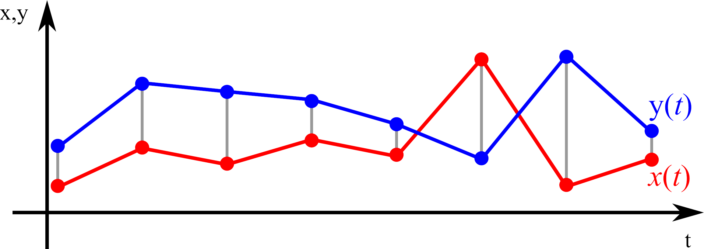
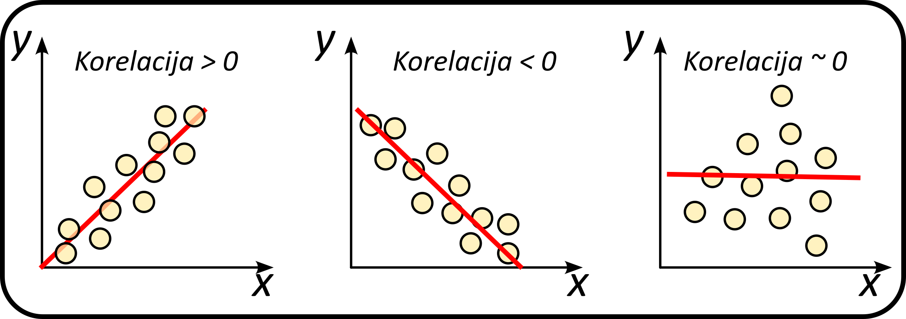

# Grupiranje podakov

Zelo pogosto se srečujemo s podatki, ki jih želimo na nek način organizirati. S tega vidika jih morda želimo razdeliti v bolj homogene skupine, za katere vemo, da imajo določene lastnosti bolj enakomerno izražene. Celovit pristop k temu problemu je zelo kompleksen, saj je odvisen od vrste podatkov, ki jih imamo na voljo, in od tega, kaj želimo doseči, pri čemer moramo pogosto biti zelo kreativni. Tukaj bomo prikazali osnovno idejo na primeru grupiranja časovnih vrst.

## Uvod

V statistiki in na sorodnih področjih je merilo podobnosti ali funkcija podobnosti realno ovrednotena funkcija, ki količinsko določa podobnost med dvema objektoma. Čeprav ni enotne opredelitve mere podobnosti, so običajno take mere v nekem smislu obratne metriki razdalje: za podobne premete imajo velike vrednosti, za zelo različne predmete pa nič ali negativno vrednost. Če imata na primer dva podatka blizu koordinat x, y, bo njuna ocena "podobnosti", torej verjetnost, da sta si podobna, veliko večja kot pri dveh podatkovnih točkah, med katerima je več prostora.

 

Tu bomo izdelali in uporabili 3 različne mere podobnosti, in sicer:
<ul>
 <li> evklidsko razdaljo </li>
 <li> korelacijo</li>
 <li> dinamično časovno deformacijo.</li>
</ul>

## Mere podobnosti

### Evklidska razdalja

Razdalja Minkowskega je metrika, ki jo lahko obravnavamo kot posplošitev evklidske razdalje in razdalje Manhattan. Recimo, da imamo dve časovni vrsti X in Y. Časovni vrsti imata obliko:

$$ X = (x_1,x_2,x_3,..., x_n) \text{ in } Y = (y_1,y_2,y_3,..., y_n) $$

Običajno se uporablja razdalja Minkowskega, pri čemer je $p$ 1 ali 2, kar ustreza Manhattnovi oziroma Evklidski razdalji. Splošna oblika razdalje Minkowskega je metrika:

$$D(X,Y) = \left(\sum_{i=1}^{n} \left| x_i - y_i \right|^p \right)$$

### Korrelacija

Korelacija ali korelacijski koeficient je številska mera, ki predstavlja moč **linearne povezanosti** dveh spremenljivk. Statistična veda s korelacijo v splošnem označuje povezanost oz. sopojavnost dveh spremenljivk v statistični populaciji ali populacijah. Korelacijo je moč meriti z več različnimi koeficienti, prilagojenimi za različne tipe podatkov, ki so na voljo. Izmed korelacijskih koeficientov je najbolj znan Pearsonov korelacijski koeficient, ki je računan na podlagi kovariance in standardnih odklonov niza obeh spremenljivk. Tukaj bomo uporabili t.i. **Pearsonov koeficient korelacije**.

Pearsonov koeficient korelacije, *r*, je matematična in statistična številska mera, ki predstavlja velikost linearne povezanosti spremenljivk $X$ in $Y$, merjenih na istem predmetu preučevanja. Koeficient je definiran kot vsota vseh produktov standardnih odklonov obeh vrednosti v razmerju s prostostnimi stopnjami, oziroma kot razmerje med kovarianco in produktom obeh standardnih odklonov:

$$ r = \frac{\sum_{i=0}^{N} (x_i - \bar x) (y_i - \bar y)}{\sqrt{\sum_{i=0}^{N}(x_i-\bar x)^2} \sqrt{\sum_{i=0}^{N}(y_i-\bar y)^2}}$$

### Warping path

V analizi časovnih vrst je dinamično časovno poravnavanje (DTW) algoritem za merjenje podobnosti med dvema časovnima zaporedjema, ki se lahko razlikujeta v hitrosti. Na primer, s pomočjo DTW bi lahko zaznali podobnosti v hoji, tudi če bi ena oseba hodila hitreje kot druga, ali če bi med opazovanjem prišlo do pospeševanj in upočasnitev. DTW se je uporabljal za časovna zaporedja video, avdio in grafičnih podatkov – dejansko lahko kateri koli podatki, ki jih je mogoče pretvoriti v enodimenzionalno zaporedje, analiziramo z DTW. Znan primer uporabe je bilo avtomatsko prepoznavanje govora, za spopadanje z različnimi hitrostmi govora. Druge aplikacije vključujejo prepoznavanje govorcev in prepoznavanje spletnih podpisov. Uporablja se lahko tudi v aplikacijah za delno ujemanje oblik.

Da bi ustvarili preslikavo med signaloma, moramo v zgornjem diagramu ustvariti pot. Pot se mora začeti v točki (0,0) in doseči točko (M,N), kjer sta (M, N) dolžini obeh signalov. Naš cilj je poiskati pot z najmanjšo razdaljo. V ta namen sestavimo matriko, ki je podobna matriki razdalj. Ta matrika bi vsebovala najmanjše razdalje za dosego določene točke, če začnemo z (0,0). Za poti, ki bi jih raziskali, uvedemo nekaj omejitev:

Pot se mora začeti v točki (0,0) in končati v točki (M,N).
Ne moremo se vrniti v preteklost, zato pot teče samo naprej, kar pomeni, da lahko iz točke (i, j) gremo samo desno (i+1, j) ali navzgor (i, j+1) ali po diagonali (i+1, j+1).
Te omejitve bi preprečile kombinatorično eksplozijo in problem pretvorile v problem dinamičnega programiranja, ki ga je mogoče rešiti v času O(MN).

Kot prvo izberemo dva signala, ki ju želimo preslikati ter za njuju določimo matriko razlik.

## Definicija problema

Ustvarite funkcijo, s katero boste lahko gnerirali $N$ časovnih vrst, ki so dogle $T_n$ in razporejene v K različnih dinamičnih skupin.

Izhajajmo iz tega, da so časovne vrste **sinusoidne oblike**, pri čemer sta amplituda in frekvenca naključni. Kljub temu, pa bomo znotraj iste skupine simulirali manjši raztros parametrov in s tem naredili časovne vrste nekoliko bolj homogene.

### Naloga 1
Ustvari graf, na katerem bodo te časovne vrste prikazane v različnih barvah, pri čemer bo vsaka barva predstavljala eno skupino. Na grafu naj bo tudi legenda, ki bo prikazovala, katera barva predstavlja katero skupino.