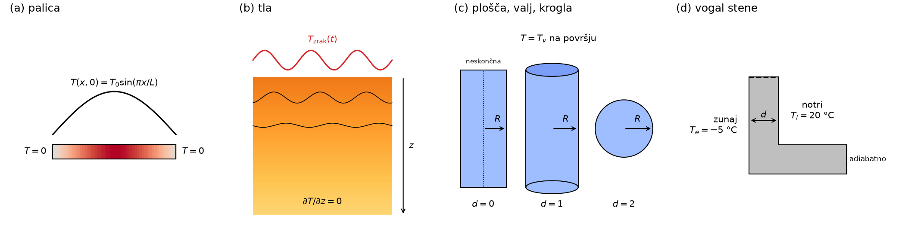

# Laboratorijski delovni list 15
## Prevajanje toplote: palica, tla, jajce in vogal stene (dodatna vaja)

Univerza v Mariboru · Fakulteta za naravoslovje in matematiko · Oddelek za fiziko

> [!IMPORTANT]
> **Programsko okolje: Python**
>
> Vse naloge rešujete **izključno v Pythonu** (virtualno okolje iz [vaje 00](../00_vaje/README.md)).
> - `numpy`: rezine (`T[1:-1]`, `T[2:]`), `np.linalg.lstsq`, `np.polyfit`, `np.select`, `np.meshgrid`
> - `scipy`: `scipy.optimize.brentq`, `scipy.special.j0`, `j1`
> - `pandas`: `pd.read_csv`
> - `matplotlib.pyplot`: `plot`, `semilogy`, `contourf`, `contour`
>
> Rešitev oddate kot Jupyter zvezek `.ipynb` z izvedenimi celicami.

PDF različica: [navodila/delovni_list_15.pdf](navodila/delovni_list_15.pdf)

---

## 1. Teoretične osnove in motivacija

Toplota se v trdnih snoveh prenaša s prevajanjem. Ista difuzijska enačba opiše ohlajanje kovinske palice, dnevno in letno nihanje temperature v tleh, kuhanje jajca in toplotne izgube skozi vogal hiše. Razlikujejo se le geometrija in robni pogoji. Na tej vaji z eno numerično metodo (eksplicitna shema FTCS) in eno iterativno metodo (Jacobi) rešimo štiri takšne primere in rezultate primerjamo z analitičnimi rešitvami.

> **Opis modela**
>
> Temperatura $T(\vec r, t)$ v snovi s toplotno prevodnostjo $\lambda$, gostoto $\rho$ in specifično toploto $c_p$ zadošča difuzijski enačbi
>
> $$\frac{\partial T}{\partial t} = D\,\nabla^2 T, \qquad D = \frac{\lambda}{\rho c_p},$$
>
> kjer je $D$ temperaturna prevodnost. Gostota toplotnega toka je $\vec q = -\lambda\nabla T$ (Fourierov zakon).

<!-- w=0.95 -->

### Eksplicitna shema FTCS

Prostor razdelimo na točke $x_i = i\,\Delta x$, čas na korake $t_n = n\,\Delta t$. Odvod po času nadomestimo z diferenco naprej, drugi odvod po prostoru pa s centralno diferenco:

$$
T_i^{n+1} = T_i^n + r\left(T_{i+1}^n - 2T_i^n + T_{i-1}^n\right), \qquad r = \frac{D\,\Delta t}{\Delta x^2}.
$$

Shema je stabilna le, če je $r \le 1/2$ (v 2D $r \le 1/4$). Pri večjem $r$ najhitreje nihajoči »cikcak« del napake v vsakem koraku naraste za faktor $|1 - 4r| > 1$. Za palico dolžine $L$ s krajiščema pri $T = 0$ in začetnim profilom $T_0\sin(\pi x/L)$ je točna rešitev

$$
T(x, t) = T_0\sin\frac{\pi x}{L}\,e^{-t/\tau}, \qquad \tau = \frac{L^2}{\pi^2 D}.
$$

### Periodični robni pogoj: tla

Če temperatura površja tal niha kot $T(0,t) = \bar T + A_0\cos\omega t$, je rešitev v globini $z$ dušen val

$$
T(z, t) = \bar T + A_0\,e^{-z/\delta}\cos\left(\omega t - \frac{z}{\delta}\right), \qquad \delta = \sqrt{\frac{2D}{\omega}} .
$$

Amplituda pada eksponentno z globino prodiranja $\delta$, faza pa zaostaja za $z/\delta$. Ker je enačba linearna, se vsak harmonik (dnevni s periodo 24 h, letni s periodo 365 dni) širi neodvisno s svojo $\delta$. Amplitudo in fazo izbranega harmonika iz časovne vrste $y(t)$ dobimo z linearno metodo najmanjših kvadratov:

$$
y(t) \approx a + b\cos\omega t + c\sin\omega t, \qquad A = \sqrt{b^2 + c^2}, \quad \varphi = \operatorname{atan2}(c, b).
$$

Na dnu računskega območja postavimo adiabatni pogoj $\partial T/\partial z = 0$, ki ga uresničimo z zrcalnim sosedom $T_{N+1} = T_{N-1}$.

### Plošča, valj in krogla

Pri simetričnih telesih je temperatura odvisna le od razdalje $r$ od središčne ravnine, osi ali središča. Laplaceov operator tedaj zapišemo enotno:

$$
\frac{\partial T}{\partial t} = D\left(\frac{\partial^2 T}{\partial r^2} + \frac{d}{r}\frac{\partial T}{\partial r}\right), \qquad d = \begin{cases} 0 & \text{plošča (debelina } 2R) \\ 1 & \text{valj} \\ 2 & \text{krogla} \end{cases}
$$

Na mreži $r_i = i\,\Delta r$ je $\Delta r / r_i = 1/i$, zato

$$
T_i^{n+1} = T_i^n + r\left[T_{i+1}^n - 2T_i^n + T_{i-1}^n + \frac{d}{2i}\left(T_{i+1}^n - T_{i-1}^n\right)\right].
$$

V središču ($i = 0$) zaradi simetrije velja $\partial T/\partial r = 0$ in $\frac{d}{r}\frac{\partial T}{\partial r} \to d\,\frac{\partial^2 T}{\partial r^2}$, zato $T_0^{n+1} = T_0^n + 2(1+d)\,r\,(T_1^n - T_0^n)$. Pogoj stabilnosti je v središču strožji kot drugje.

Če je površje ves čas pri temperaturi $T_v$, se brezdimenzijska temperatura središča $\theta = (T_v - T_c)/(T_v - T_0)$ po kratkem prehodnem času spreminja kot

$$
\theta(t) \approx C_1\,e^{-t/\tau}, \qquad \tau = \frac{R^2}{\beta^2 D},
$$

kjer je $\beta = \pi/2$, $C_1 = 4/\pi$ za ploščo, $\beta = 2{,}405$ (prva ničla Besslove funkcije $J_0$), $C_1 = 2/(\beta J_1(\beta)) = 1{,}602$ za valj ter $\beta = \pi$, $C_1 = 2$ za kroglo.

### Stacionarno prevajanje v 2D: vogal stene

V stacionarnem stanju je $\nabla^2 T = 0$. Prerez stene razdelimo na kvadratne celice velikosti $h$. Za vsako celico zidu mora biti vsota tokov iz štirih sosedov enaka nič:

$$
\sum_{k=1}^{4} G_k\,(T_k - T) = 0 \quad\Rightarrow\quad T = \frac{\sum_k G_k T_k}{\sum_k G_k},
$$

kjer je $G_k$ prevodnost (na meter dolžine vogala) med celico in sosedom $k$. Med dvema celicama zidu je $G = \lambda$, med celico in zrakom $G = h/(h/(2\lambda) + R_s)$, kjer je $R_s$ površinska toplotna upornost ($R_{si} = 0{,}13\ \mathrm{m^2K/W}$ notri in $R_{se} = 0{,}04\ \mathrm{m^2K/W}$ zunaj). Na prerezu daleč od vogala je tok nič ($G = 0$). **Jacobijeva iteracija** zgornjo enačbo ponavlja za vse celice hkrati, dokler se temperature ne nehajo spreminjati.

Za ravno steno debeline $d$ velja

$$
U = \frac{1}{R_{si} + d/\lambda + R_{se}}, \qquad q = U\,(T_i - T_e), \qquad T_{si} = T_i - R_{si}\,q .
$$

Vogal izgublja več toplote, kot bi jo dva ravna kraka. Razliko opiše **linijska toplotna prehodnost** $\psi = Q/(T_i - T_e) - U L_n$ [W/(m K)], kjer je $Q$ toplotni tok skozi notranjo površino (na meter višine) in $L_n$ notranja dolžina obeh krakov. Nevarnost plesni ocenimo s **temperaturnim faktorjem** $f_{Rsi} = (T_{si} - T_e)/(T_i - T_e)$; nemški standard DIN 4108-2 zahteva $f_{Rsi} \ge 0{,}70$ (pri $T_e = -5$ °C, $T_i = 20$ °C je to $T_{si} \ge 12{,}5$ °C).

> **Predpostavke o podatkih in parametrih**
>
> - Palica: $L = 1$ m, $D = 10^{-4}\ \mathrm{m^2/s}$ (aluminij), 51 točk, $T_0 = 100$ °C.
> - Tla: $D = 5\cdot10^{-7}\ \mathrm{m^2/s}$ (vlažna zemlja), $\Delta z = 2$ cm, globina 8 m. Temperatura površja je enaka urni temperaturi zraka iz [`11_vaje/navodila/Vreme_urni.csv`](../11_vaje/navodila/Vreme_urni.csv) (Maribor, 2021), kar je poenostavitev: sevanja, snega in izhlapevanja ne upoštevamo. Leto simuliramo dvakrat, prvo leto služi za ustalitev.
> - Jajce: krogla z $R = 2{,}2$ cm, $D = 1{,}4\cdot10^{-7}\ \mathrm{m^2/s}$, začetna temperatura 5 °C (hladilnik), voda 100 °C; za primerjavo plošča in valj z enakim $R$. Rumenjak je trd pri približno 70 °C.
> - Stena: $d = 30$ cm, $\lambda = 0{,}8$ W/(m K) (polna opeka) ali $0{,}2$ W/(m K) (porobeton), $T_i = 20$ °C, $T_e = -5$ °C, območje $1{,}5\ \mathrm{m} \times 1{,}5\ \mathrm{m}$, $h = 1$ cm.

---

## 2. Pripravljalna naloga (analitični del)

**P1. Stabilnost.** (a) Kolikšen je največji časovni korak sheme FTCS za tla ($D = 5\cdot10^{-7}\ \mathrm{m^2/s}$) pri $\Delta x = 1$ cm? Koliko korakov potrebujemo za eno leto? (b) Iz enačbe za središče krogle pokažite, da mora biti $r \le 1/(2(1+d))$. Kolikšen je največji $r$ za kroglo?

$\Delta t_{\max}=$ `________`  korakov na leto $=$ `________`  $r_{\max}$ (krogla) $=$ `________`

**P2. Globina prodiranja.** Izračunajte $\delta$ za dnevno in letno nihanje v tleh ter časovni zamik na globini $z = \delta$. Na kateri globini je amplituda letnega nihanja le še 10 % amplitude na površju?

| | $\delta$ [m] | zamik pri $z = \delta$ | $z$ pri 10 % amplitude [m] |
|---|---|---|---|
| dan | `______` | `______` h | `______` |
| leto | `______` | `______` dni | `______` |

*Preglednica P1: Globina prodiranja temperaturnih nihanj v tla.*

**P3. Časovne konstante.** Izrazite $\tau$ za ploščo, valj in kroglo v enotah $R^2/D$. V kakšnem razmerju so? S pomočjo razmerja površine in prostornine pojasnite, zakaj se krogla segreje najhitreje.

$\tau_{\rm plošča}=$ `______`  $\tau_{\rm valj}=$ `______`  $\tau_{\rm krogla}=$ `______` $R^2/D$

**P4. Kuhanje jajca.** S prvim členom vrste $\theta \approx 2\,e^{-\pi^2 D t/R^2}$ ocenite, koliko časa po potopitvi v vrelo vodo doseže središče jajca iz hladilnika 70 °C. Koliko dlje bi kuhali jajce s polmerom 2,5 cm?

$t_{70}\,(R = 2{,}2\ \mathrm{cm})=$ `__________`  $t_{70}\,(R = 2{,}5\ \mathrm{cm})=$ `__________`

---

## 3. Laboratorijske naloge na računalniku (Python)

> **Repozitorij**
>
> Začetna predloga je v repozitoriju predmeta: [`15_vaje/vaje_15.ipynb`](vaje_15.ipynb). Funkciji za geometrijo vogala in prevodnosti (`vogal`, `prevodnosti`) ter tok v notranjo površino (`tok_notri`) sta že napisani. V razdelku *Funkcije* dopolnite telesa funkcij z oznako `TODO`, v razdelku *Testno območje* pa preverite rezultate nalog P1–P4.

### Naloga 1: Palica in stabilnost sheme (20 min)

1. Dopolnite funkcijo `ftcs_1d(T, r, n_korakov)`. Uporabite rezine, ne zanke po točkah.
2. Za $r = 0{,}25$, $0{,}45$, $0{,}50$ in $0{,}55$ izračunajte temperaturo po $t = 1000$ s in jo primerjajte z analitično rešitvijo.
3. **Slika 2** (dva panela): stabilne rešitve z analitično krivuljo ter rešitev pri $r = 0{,}55$.

| $r$ | $\Delta t$ [s] | korakov | $T(L/2)$ [°C] | analitično [°C] | največja napaka [°C] |
|---|---|---|---|---|---|
| 0,25 | `____` | `____` | `______` | `______` | `______` |
| 0,45 | `____` | `____` | `______` | `______` | `______` |
| 0,50 | `____` | `____` | `______` | `______` | `______` |
| 0,55 | `____` | `____` | `______` | `______` | `______` |

*Preglednica 1: Natančnost in stabilnost sheme FTCS za palico.*

### Naloga 2: Temperatura v tleh (25 min)

1. Dopolnite funkciji `tla(T_pov, z, D, dt, T0)` (korak FTCS z adiabatnim dnom) in `harmonik(y, t, perioda)`.
2. Simulirajte tla z urnimi temperaturami zraka za leto 2021 ($\Delta t = 300$ s). **Slika 3** (dva panela): temperatura na globinah 0, 10, 20 in 50 cm v enem tednu julija ter na globinah 0, 1, 2 in 4 m skozi celo leto.
3. Za vse globine iz preglednice določite amplitudo in zamik dnevnega in letnega harmonika. **Slika 4** (dva panela): $\ln A(z)$ in zamik v odvisnosti od globine. Iz naklona $\ln A(z)$ določite $\delta$ in jo primerjajte s P2.

| $z$ [m] | dnevna $A$ [°C] | dnevni zamik [h] | letna $A$ [°C] | letni zamik [dni] |
|---|---|---|---|---|
| 0 | `______` | 0 | `______` | 0 |
| 0,1 | `______` | `______` | `______` | `______` |
| 0,2 | `______` | `______` | `______` | `______` |
| 0,5 | `______` | `______` | `______` | `______` |
| 1 | — | — | `______` | `______` |
| 2 | — | — | `______` | `______` |
| 4 | — | — | `______` | `______` |

*Preglednica 2: Dušenje in zamik temperaturnih nihanj v tleh. Iz naklona: $\delta_{\rm dan}=$ `______`, $\delta_{\rm leto}=$ `______`.*

### Naloga 3: Plošča, valj in krogla – kuhanje jajca (25 min)

1. Dopolnite funkcijo `radialno(T0, T_ok, d, D, R, N, t_kon, r)` z enačbo za notranje točke in za središče. Uporabite $r = 0{,}15$ (zakaj ta vrednost? glej P1).
2. Za $d = 0$, 1 in 2 izračunajte temperaturo v središču v prvi uri po potopitvi v vrelo vodo. Iz naklona $\ln\theta(t)$ v območju $0{,}01 < \theta < 0{,}3$ določite $\tau$ in odčitajte čas, ko središče doseže 70 °C.
3. **Slika 5** (dva panela): temperatura v središču v odvisnosti od časa in $\theta(t)$ v logaritemski skali.

| Geometrija | $\beta^2$ | $\tau$ teor. [s] | $\tau$ sim. [s] | $t_{70}$ sim. [min] | $t_{70}$ vrsta [min] |
|---|---|---|---|---|---|
| plošča ($d = 0$) | `____` | `______` | `______` | `______` | `______` |
| valj ($d = 1$) | `____` | `______` | `______` | `______` | `______` |
| krogla ($d = 2$) | `____` | `______` | `______` | `______` | `______` |

*Preglednica 3: Segrevanje središča teles s polmerom $R = 2{,}2$ cm v vreli vodi. Primerjava krogle s P4: `______`.*

### Naloga 4: Vogal stene – toplotni most (20 min)

1. Dopolnite funkcijo `jacobi(tip, G, T_i, T_e, T_zac)`. Za začetni približek uporabite profil ravne stene, ki ga za vas izračuna zvezek.
2. Izračunajte stacionarno temperaturo vogala za $\lambda = 0{,}8$ in $0{,}2$ W/(m K). Iz toka `tok_notri` izračunajte $Q$, $\psi$ ter najnižjo površinsko temperaturo $T_{si}$ na notranji strani.
3. **Slika 6** (dva panela): izoterme v vogalu za $\lambda = 0{,}8$ W/(m K) in $T_{si}$ v odvisnosti od razdalje od notranjega vogala za obe vrednosti $\lambda$.

| $\lambda$ | $U$ | $Q$ | $U L_n \Delta T$ | $\psi$ | $T_{si}$ ravna | $T_{si}$ vogal | $f_{Rsi}$ vogal |
|---|---|---|---|---|---|---|---|
| 0,8 | `____` | `____` | `____` | `____` | `____` | `____` | `____` |
| 0,2 | `____` | `____` | `____` | `____` | `____` | `____` | `____` |

*Preglednica 4: Toplotni most v zunanjem vogalu stene debeline 30 cm. Enote: $\lambda$ in $\psi$ v W/(m K), $U$ v W/(m²K), $Q$ in $U L_n \Delta T$ v W/m, $T_{si}$ v °C.*

---

## 4. Vprašanja za razpravo in zaključni zagovor

> **Razmislek 1: Cena eksplicitne sheme**
>
> Pogoj $r \le 1/2$ pomeni, da se pri dvakrat gostejši mreži število korakov poveča za faktor 4, delo pa za faktor 8. Koliko korakov bi potrebovali za tla z $\Delta z = 2$ mm? Kako ta problem odpravijo implicitne sheme (Crank-Nicolson) in kakšna je njihova cena?

> **Razmislek 2: Klet in vodovod**
>
> Zakaj v kleti skoraj ne čutimo dnevnih sprememb temperature? Zakaj so tla na globini 4 m najtoplejša šele jeseni? Na kateri globini je treba položiti vodovodno cev, da pozimi ne zmrzne, in kaj se pri tem zgodi s poletno temperaturo vode?

> **Razmislek 3: Oblika in velikost**
>
> Kako je čas kuhanja odvisen od velikosti jajca ($t \propto R^2$)? Kolikokrat dlje bi kuhali nojevo jajce ($R \approx 7$ cm)? Zakaj krompir narežemo na kocke, preden ga skuhamo?

> **Razmislek 4: Plesen v vogalu**
>
> Zakaj je notranji kot zunanjega vogala hladnejši od ravne stene, čeprav je stena povsod enako debela? Zakaj boljša toplotna izolacija (manjši $\lambda$) zmanjša tudi nevarnost plesni? Kako bi v model dodali 10 cm zunanje izolacije z $\lambda = 0{,}04$ W/(m K) (domača naloga)?

---

### Dodatno gradivo

- [`resitve/vaje_15_resitev.ipynb`](resitve/vaje_15_resitev.ipynb): rešitev z izvedenimi celicami
- [`navodila/geometrije.png`](navodila/geometrije.png): shema štirih geometrij
- Vremenski podatki so v mapi [`../11_vaje/navodila/`](../11_vaje/navodila/)
